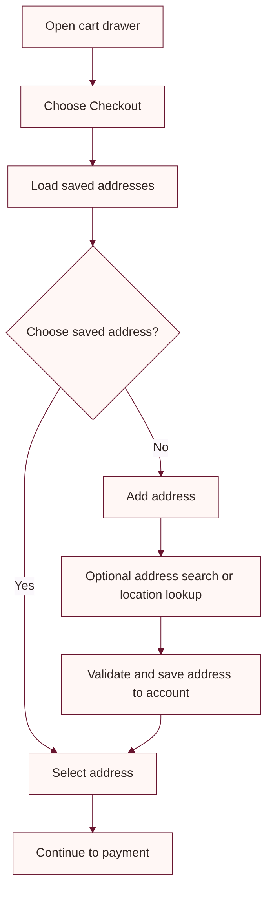

# Checkout address flow

Checkout lets a signed-in customer choose or manage delivery addresses in the cart drawer.

## Customer flow



Address records are scoped to the signed-in customer. The first saved address becomes the default unless another address is already present; customers can change the default.

## Address lookup

Google Places/address autocomplete is optional and uses the frontend setting `Google:MapsApiKey`. Restrict any browser key to the production site origin and the APIs enabled for the feature.

The current-location action requires the customer's explicit browser permission. When Google Maps is not configured, the application uses a backend OpenStreetMap/Nominatim reverse-geocoding fallback. Treat returned address data as a suggestion; the customer should review and correct it before saving.

## Database

The customer-address schema is included in the backend EF Core migrations. The API applies pending migrations at startup when the database is reachable. To update it manually from the repository root:

```powershell
dotnet ef database update --project backend/backend.csproj --startup-project backend/backend.csproj
```

Relevant API routes are under `/api/addresses` and require the customer's authentication token.
