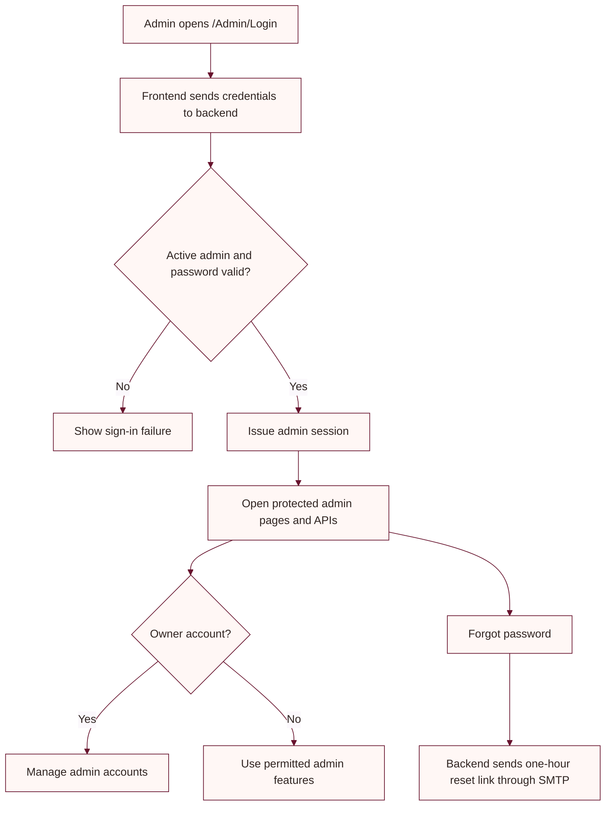

# Admin panel setup

The admin panel is part of the existing MVC storefront and backend API.

## Local URLs

| Page | Development URL |
|---|---|
| Storefront | `https://localhost:5001/` |
| Admin login | `https://localhost:5001/Admin/Login` |
| Backend Swagger | `https://localhost:56738/swagger` |

Use the launch profiles in the root [README](README.md) to start the API and website.

## First administrator

Administrator records are stored in `dbo.AdminUsers`. The application does not seed a default administrator or provide a first-owner bootstrap command. Provision the initial owner account through a controlled deployment procedure, using a BCrypt-compatible password hash and a unique email. Do not rely on credentials copied from old examples or documentation.

The account whose email is `admin@ubhaya.com` is treated as the owner by the admin-account API. It must remain active and keep that email. After this owner account exists, it can create and manage other admin accounts from the protected admin account workflow. Keep the owner mailbox and credentials under organization control.

## Admin capabilities

- Dashboard and catalog management
- Product and image updates
- Variant stock management and inventory history
- Order list and status management
- Payment status visibility
- Delhivery shipment creation/retry actions
- Admin password reset and password change

Admin APIs require an Admin role token. The frontend uses a separate admin cookie from the customer sign-in cookie.

## Account recovery

Forgot-password links require backend SMTP configuration. See [backend account setup](backend/ACCOUNT_SETUP.md). Reset links are single-use and expire after one hour.

## Database and uploaded media

The backend applies EF Core migrations during startup. The database must be reachable before starting the API. Run migrations explicitly when managing schema separately:

```powershell
dotnet ef database update --project backend/backend.csproj --startup-project backend/backend.csproj
```

The API and storefront must use the same `UploadsPath` for shared media. The example in `backend/appsettings.example.json` is `C:\UbhayaFashions\Uploads`; Linux/container deployments should use a persistent shared volume. Keep uploads outside ephemeral publish folders and back them up with the database.

## Sign-in and management flow


