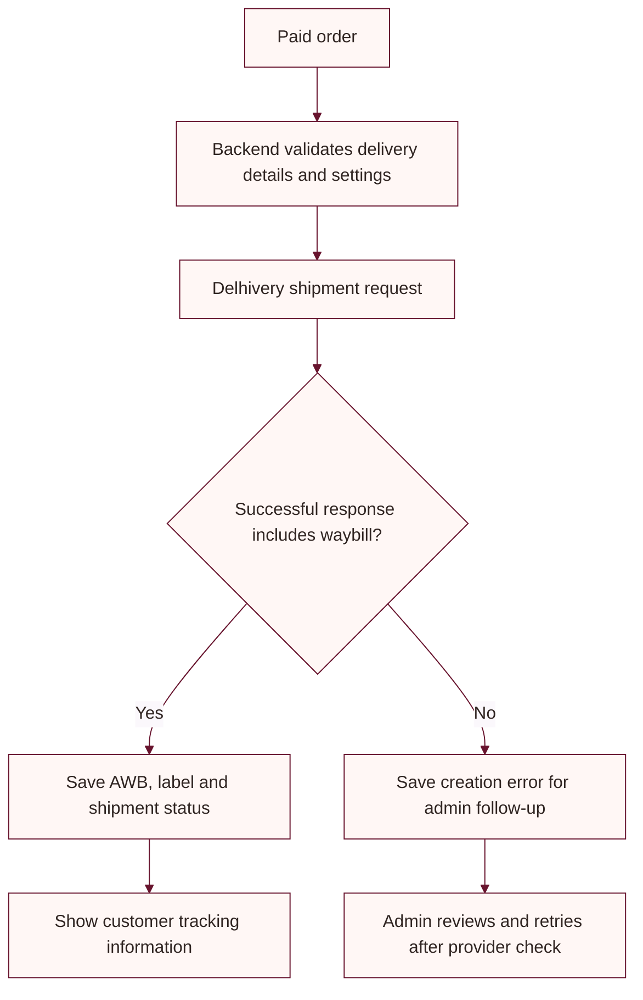

# Delhivery integration setup

The Delhivery API token and shipment calls stay on the backend. The browser must never call Delhivery directly or receive the provider token.

## Backend configuration

Configure values in a local secret store or hosting environment. .NET environment-variable names use double underscores.

| Setting | Purpose |
|---|---|
| `Delhivery:Environment` | Select staging or production |
| `Delhivery:BaseUrl` | Optional account-specific base URL override |
| `Delhivery:ApiToken` | Token for the selected environment |
| `Delhivery:ClientName` | Exact client name registered with the account |
| `Delhivery:PickupLocationName` | Exact active pickup location name |
| `Delhivery:SellerName`, `SellerAddress`, `SellerPin`, `SellerPhone` | Seller details required in shipment payload |
| `Delhivery:LabelBaseUrl` | Optional label endpoint override |

Confirm values and live activation with the Delhivery account administrator. Do not guess the case-sensitive client or pickup-location name. Never enable payload logging during routine operation because shipment payloads contain customer details.

## Shipment flow

For prepaid orders, automatic shipment creation is attempted after payment is finalized. COD orders use the normal order flow and are not automatically manifested by that path. A failed carrier request does not reverse a captured payment.

## Admin API routes

These backend routes require an Admin role:

- `GET /api/admin/delhivery/serviceability/{postalCode}`
- `GET /api/admin/delhivery/shipping-cost`
- `POST /api/admin/delhivery/pickup-request`

Shipment create/retry operations are part of the admin orders API. Customers can request their own order tracking through `GET /api/orders/{id}/tracking`; order ownership is checked by the backend.

The manual admin create/retry operation is `POST /api/admin/orders/{orderId}/delhivery-shipment`. It checks the order/payment state and destination serviceability before manifesting a shipment; only a confirmed provider response is saved as shipment-created.

Rate responses are estimates. Delhivery staging can return zero charges, so do not treat a staging estimate as a production quote.

## Troubleshooting

- A client-name or pickup-location error usually means the configured value differs from the active account value. Confirm it in Delhivery One before retrying.
- If a request times out, first check the provider portal for an existing shipment to avoid creating a duplicate.
- The backend stores shipment status, waybill, label URL, attempt count, and the latest error on the order's shipment record.

## Checkout delivery charges

For prepaid checkout orders with a product subtotal below ₹1,000, the backend:

1. Uses `Delhivery:SellerPin` as the shipment origin PIN and the customer's delivery PIN as the destination.
2. Checks that Delhivery supports prepaid delivery to the destination PIN.
3. Requests an estimated Surface rate for the same 1 kg parcel used by automatic shipment creation.
4. Adds Delhivery's `total_amount` estimate to the Razorpay order amount and displays the product subtotal, delivery charge, and payable total on the secure payment page.

Orders with a product subtotal of ₹1,000 or more receive free shipping and do not call the rate API.

The invoice charge API returns an approximate amount, not a guaranteed final invoice. Delhivery staging does not return live rate-card amounts; checkout deliberately blocks a below-threshold payment if the quote is zero. Configure `Delhivery:Environment=Production`, a valid production API token, and the correct six-digit `Delhivery:SellerPin` before accepting live orders below ₹1,000.
