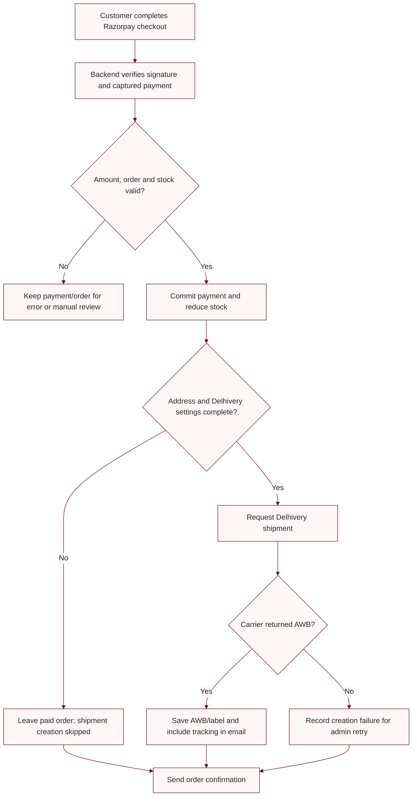

# Razorpay to Delhivery automation

The verified prepaid payment path attempts Delhivery shipment creation after payment finalization. A carrier failure does not roll back a captured payment. Admins can inspect and retry shipment creation from the Orders workflow.

## Event flow

## Required backend settings

Configure the Delhivery token for the selected environment, environment/base URL, exact pickup location name, client name, and seller details. See [Delhivery setup](DELHIVERY_SETUP.md). Configure order email settings as described in [account setup](backend/ACCOUNT_SETUP.md).

The automated shipment currently uses a default parcel weight of 1000 grams. Confirm actual package weight and provider requirements before live orders.

## Controlled test checklist

1. Use Razorpay test credentials and Delhivery staging configuration.
2. Use a controlled test customer and destination supported by the staging account.
3. Confirm the checkout amount and destination address.
4. Complete a test payment and confirm the backend returns a paid order.
5. Inspect the order and shipment record for an AWB or a recorded failure.
6. Confirm the confirmation email reflects whether tracking information is available.
7. If creation failed, inspect the recorded provider error and retry only after checking Delhivery One for a possibly-created shipment.

The regular `/api/payments/verify` path and the Razorpay webhook can finalize a captured payment and attempt the paid-order shipment flow. The test-only `/api/payments/test-success` shortcut and COD order flow do not run this same automatic shipment path.
