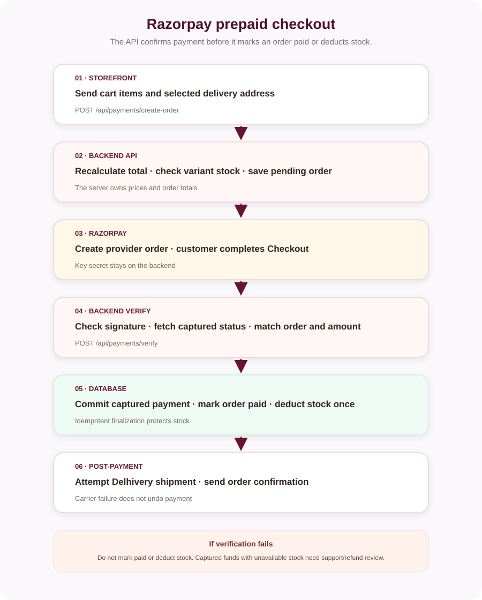

# Razorpay payment setup

Razorpay payment creation and verification run through the backend. The key secret must remain server-side.

## Configuration

Set these backend settings in a local secret store or hosting environment:

| Setting | Use |
|---|---|
| `Razorpay:KeyId` | Public checkout key ID returned to the frontend |
| `Razorpay:KeySecret` | Server-side order and payment verification |
| `Razorpay:WebhookSecret` | Signature verification for webhook events |

For environment variables, use the .NET double-underscore form such as `Razorpay__KeySecret`. Use Razorpay test credentials for testing, and never commit real credentials.

The EF Core schema already includes payment and webhook tables. The backend applies migrations at startup. Use `dotnet ef database update --project backend/backend.csproj --startup-project backend/backend.csproj` when your deployment process applies schema changes separately; do not create a duplicate migration for an existing feature.

## Payment flow

The backend recalculates item prices and validates stock when it creates the order. A browser redirect alone is not proof of payment: the verify endpoint validates the signature and checks payment status, order reference, and amount with Razorpay before marking the order paid. Stock is reduced only during successful payment finalization.

A verified Razorpay webhook is also supported at `POST /api/payment/razorpay/webhook`. See [webhook setup](docs/RAZORPAY_WEBHOOK_SETUP.md).

## Test-only payment shortcut

`POST /api/payments/test-success` is a test-only endpoint controlled by backend setting `PaymentTesting:Enabled`. Keep it disabled or unset outside an isolated test environment. It does not contact Razorpay.
