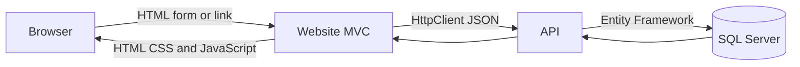
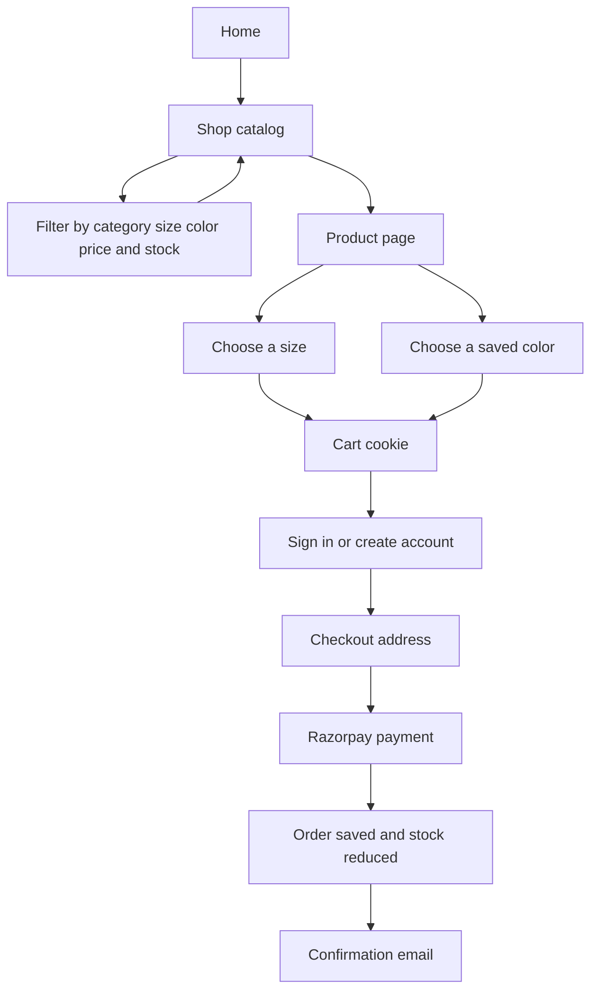
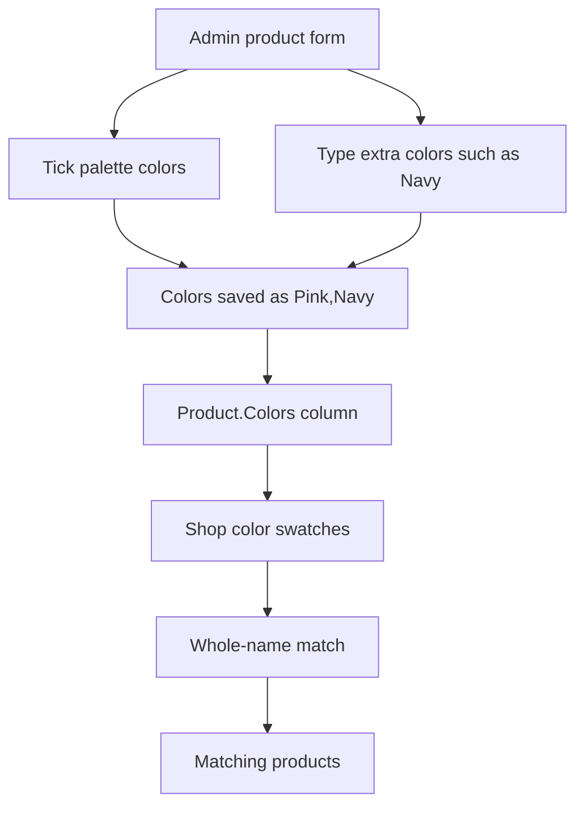
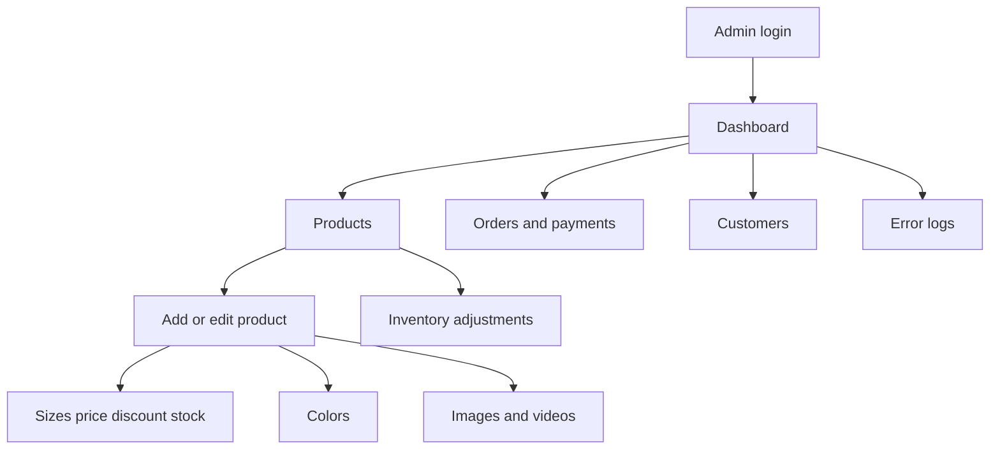

# Ubhaya Fashions

Ubhaya Fashions is a women’s clothing store. Shoppers browse the catalog, filter by size, color, and price, save a wishlist, and pay with Razorpay. Staff manage products, stock, orders, and customers from the admin area.

The application is two ASP.NET Core 8 projects plus SQL Server:

| Part | Project | Local URL |
| --- | --- | --- |
| Store and admin website | `frontend` | http://localhost:5000 |
| JSON API | `backend` | http://localhost:5080 |
| SQL Server | Docker Compose service `db` | `localhost,1433` |

The website never talks to the database. It calls the API. The API is the only process that uses Entity Framework and SQL Server.

## Start locally

From the project folder:

```bash
./start.sh
```

That script:

1. Starts SQL Server with Docker Compose.
2. Waits until SQL Server accepts connections.
3. Builds and starts the API on port 5080.
4. Builds and starts the website on port 5000.
5. Writes logs to `.run/api.log` and `.run/store.log`.

Open:

- Store: http://localhost:5000
- Admin: http://localhost:5000/Admin/Login
- API docs (development only): http://localhost:5080/swagger

Requirements: .NET 8 SDK and Docker. `start.sh` sets the local database connection, JWT settings, and `ApiBaseUrl` for that process. Do not reuse those local values in production.

`docker-compose.yml` can run the database, API, and website as containers. In that layout the website is published on port 5173 and the API on port 5000. Day-to-day local work uses `./start.sh` instead, because the website then stays on port 5000.

## How a page is built



Most catalog data is loaded on the server before the HTML is sent. The browser also calls website actions for the cart drawer, reviews, notifications, and address save. Those actions call the API again.

Signed-in customers use a cookie on the website. The website exchanges that session for a JWT when it calls the API. Admin sign-in is a separate cookie plus an admin JWT. A customer token cannot call admin APIs.

## Customer flow



1. **Home** shows the hero, new arrivals, and categories marked for the home page.
2. **Shop** (`/Products`) lists products. Filters are sent as query string values and applied by `GET /api/products`.
3. **Search keeps the current filters.** Size, color, price, availability, and sort stay in hidden fields, so a search does not clear a color the shopper already chose.
4. **Product page** shows photos, sizes, stock, reviews, and the colors saved for that product. The chosen color is sent with the size when the item is added to the bag.
5. **Cart** is stored in an HTTP-only cookie named `cart` for 30 days. It holds the product, size, color, price, and quantity. The website checks live stock before adding or changing a line.
6. **Account** supports email sign-up with a verification code, password sign-in, and optional Google or Facebook sign-in when those keys are set.
7. **Checkout** collects a delivery address. Saved addresses are available after sign-in.
8. **Payment** creates a Razorpay order through `POST /api/payments/create-order`. The browser completes payment with Razorpay, then the website verifies the signature. Stock is reduced and a confirmation email is sent.
9. Test payment buttons appear only when `PaymentTesting:Enabled` is true. Leave that false outside local testing.

The price slider starts at ₹0 and runs at least to ₹10,000. If any variant costs more, the upper end moves up to the next ₹100.

## Color filter



Admin and the shop share one palette: Black, White, Red, Pink, Green, Blue, Yellow, Maroon, Purple, Beige, Orange, and Gold. Extra names typed in **Other color** are stored as well and appear as labeled swatches.

A filter matches a whole color name. **Red** matches a product saved as `Red,Maroon`. It does not match a product saved only as `Maroon`.

## Admin flow



Admin pages live under `/Admin`. **Logout** is in the top bar next to the admin name.

Only the owner account `admin@ubhaya.com` sees **Admin accounts**. Other admin users can manage the catalog, orders, and their own password.

## Projects

### Website (`frontend`)

- Razor views in `Views`.
- Controllers call `Services/ApiService.cs` or `Services/AdminApiService.cs`.
- Shared chrome is `Views/Shared/_Layout.cshtml`. While it renders, category, cart, wishlist, address, and profile calls run together instead of one after another. Categories and cart products are cached for a short time.
- Static files are in `wwwroot`.

### API (`backend`)

- Controllers under `Controllers` expose `/api/...`.
- `Data/ApplicationDbContext.cs` is the EF Core model.
- Migrations live in `Migrations`. `Program.cs` also applies a few idempotent column checks for older databases.
- Uploaded product files are stored under the `UploadsPath` folder and served from `/uploads`.

### Tests

```bash
dotnet test tests/UbhayaFashions.Tests/UbhayaFashions.Tests.csproj
```

`ProductCatalogTests` checks color name matching and the price-slider ceiling. Color matching treats `Pink`, `pink`, and `Pink, Beige` as the color Pink, and it refuses to treat Maroon as Red.

## Configuration

Set these for a real deployment. Do not commit live secrets.

| Setting | Where | Purpose |
| --- | --- | --- |
| `ConnectionStrings:DefaultConnection` | API | SQL Server |
| `Jwt:Key`, `Jwt:Issuer`, `Jwt:Audience` | API | Signs API tokens. The key must be at least 32 characters. |
| `FrontendUrl` | API | Browser origin allowed to call the API. Swagger is enabled only in Development. |
| `ApiBaseUrl` | Website | API address, including the trailing slash when the website uses a relative path. |
| `UploadsPath` | Both | Folder for product images and videos. |
| `Google` and `Facebook` | Website | Optional social sign-in. Callback URLs must match the website origin. |
| `PaymentTesting:Enabled` | Both | Shows the checkout test-payment buttons when true. |
| Razorpay key id and secret | API | Live card and UPI payments. |

Google and Facebook callback paths are `/signin-google` and `/signin-facebook` on the website URL.

## Main API groups

| Area | Route |
| --- | --- |
| Products, colors, price bounds | `/api/products` |
| Categories | `/api/categories` |
| Customer auth and profile | `/api/auth` |
| Cart checkout orders | `/api/orders` |
| Razorpay | `/api/payments` |
| Wishlist and recently viewed | `/api/wishlist`, `/api/recently-viewed` |
| Addresses | `/api/addresses` |
| Reviews | `/api/products/{id}/reviews` |
| Admin sign-in | `/api/admin/auth` |
| Admin catalog, stock, orders | `/api/admin/...` |

Admin routes require an admin JWT. Customer routes that change an order, address, or wishlist require a customer JWT.
