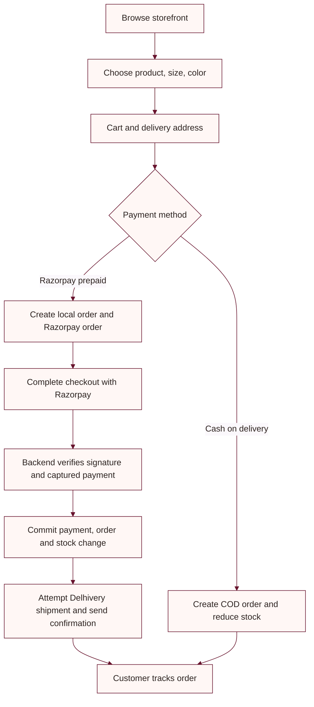

# UBHAYA FASHIONS

UBHAYA FASHIONS is a Jaipuri-style clothing storefront built with ASP.NET Core MVC, an ASP.NET Core Web API, SQL Server, and Entity Framework Core.

## Repository map

| Path | Responsibility |
|---|---|
| `frontend/` | Storefront and admin MVC application, Razor views, browser JavaScript, static assets |
| `backend/` | JSON API, authentication, commerce rules, EF Core models and migrations |
| `tests/` | xUnit tests for backend domain behavior |
| `docs/` | Product, architecture, schema, security, design, and testing notes |
| Root setup guides | Address checkout, administrator accounts, Razorpay, and Delhivery |

The frontend calls the backend through `ApiService` and `AdminApiService`. The backend is the source of truth for product prices, stock, order status, and payment state.

## Run locally

Prerequisites: .NET 8 SDK and a reachable SQL Server database. Configure the backend connection string and a long random JWT signing key in a local secret store or environment variables. Never commit real credentials.

Start the API in one terminal:

```powershell
dotnet run --project backend/backend.csproj --launch-profile backend
```

The development profile listens at `https://localhost:56738` and `http://localhost:56739`. Swagger is at `https://localhost:56738/swagger`.

Start the storefront in a second terminal:

```powershell
dotnet run --project frontend/LadiesDressStore.Web.csproj --launch-profile LadiesDressStore.Web
```

The development profile listens at `https://localhost:5001` and `http://localhost:5000`. The frontend's `ApiBaseUrl` must point to the API URL; the checked-in development setting uses `https://localhost:56738/`.

The API applies EF Core migrations during startup. Make sure the configured database is available before starting it. For an explicit schema update from the repository root:

```powershell
dotnet ef database update --project backend/backend.csproj --startup-project backend/backend.csproj
```

## Docker Compose

`docker compose up --build` starts SQL Server, API, and frontend. The website is exposed at `http://localhost:5173`, the API at `http://localhost:5000`, and SQL Server at `localhost:1433`. Compose requires `FRONTEND_URL` in a local `.env` file. The current compose file contains development placeholders; replace them with secure environment-specific configuration before using any shared or production environment.

## Main customer flow



## Build and tests

Run from the repository root:

```powershell
dotnet build LadiesDressStore.sln
dotnet test tests/UbhayaFashions.Tests/UbhayaFashions.Tests.csproj
```

The current test project contains product catalog normalization and pricing tests. These commands are available for contributors; this documentation update does not imply they were run.

## Documentation

- [Documentation index](docs/README.md)
- [Application flow](docs/APP_FLOW.md)
- [Architecture](docs/ARCHITECTURE.md)
- [Backend schema](docs/BACKEND_SCHEMA.md)
- [Security notes](docs/SECURITY.md)
- [Testing guide](docs/TESTING.md)
- [Contributor instructions](docs/AGENTS.md)
- [Address checkout setup](ADDRESS_CHECKOUT_SETUP.md)
- [Admin setup](ADMIN_SETUP.md)
- [Razorpay setup](RAZORPAY_SETUP.md)
- [Delhivery setup](DELHIVERY_SETUP.md)
