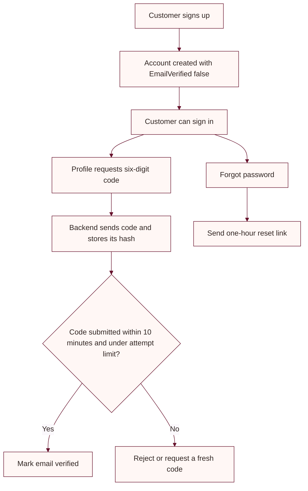

# Customer and email account setup

Customer account, password reset, email verification, and order email flows use backend SMTP configuration. Keep SMTP credentials in a secure local or hosting secret store.

## SMTP settings

| Environment variable | Purpose |
|---|---|
| `Smtp__Host` | SMTP server |
| `Smtp__Port` | SMTP port (application default is 587 when omitted) |
| `Smtp__Username` | SMTP login, if required |
| `Smtp__Password` | SMTP password or provider app password |
| `Smtp__From` | Sender address |
| `Smtp__EnableSsl` | Enable transport security |

Do not commit SMTP passwords. For Gmail, use the provider's current app-password requirements and verify sender permissions with the account owner.

## Customer sign-up and email verification

The current signup endpoint creates an unverified customer account and allows the customer to sign in. Email verification is then requested from the signed-in profile. Verification codes are six digits, expire after 10 minutes, allow at most five incorrect attempts, and can be resent once per minute. The backend stores a hash of the code.

The API also retains a pending-signup verification route for a separate flow. The active storefront signup uses immediate account creation followed by optional verification from the profile.

## Password reset

Customer password reset links expire after one hour and are single-use. The backend stores a hash of the token and clears it after successful use. The flow requires SMTP and the matching customer account schema.

## Email flow



## Database

The backend applies EF Core migrations during startup. If schema is managed separately, update it from the repository root:

```powershell
dotnet ef database update --project backend/backend.csproj --startup-project backend/backend.csproj
```
