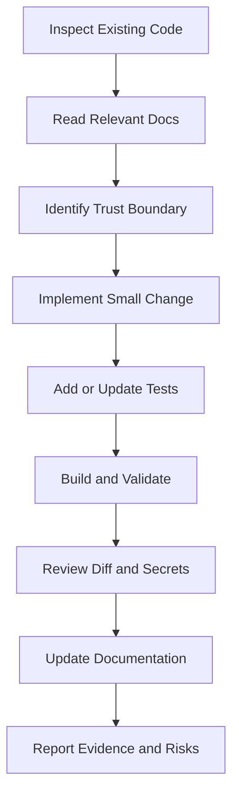

<div class="doc-hero"><span class="doc-kicker">UBHAYA FASHIONS · CONTRIBUTOR HANDBOOK</span><span class="doc-pill">AI and developer instructions</span><h1>Agent & Contributor Guide</h1><p>Rules for AI coding assistants and human contributors working safely in the UBHAYA FASHIONS repository.</p><div class="doc-meta"><div><strong>Audience</strong>Developers · AI agents</div><div><strong>Repository</strong>UbhayaFashions</div><div><strong>Goal</strong>Safe, verifiable changes</div></div></div>

## <strong>01</strong> Mission

Improve UBHAYA FASHIONS while preserving customer journeys, business rules, data integrity and production stability.

## <strong>02</strong> Repository map

| Path | Purpose |
|---|---|
| `frontend/` | ASP.NET Core MVC storefront and admin website |
| `backend/` | ASP.NET Core Web API and business logic |
| `backend/Data/` | EF Core database context |
| `backend/Migrations/` | Database migrations |
| `tests/` | Automated tests |
| `docs/` | Product and engineering documentation |
| Root setup guides | Admin, checkout, Razorpay and Delhivery instructions |

## <strong>03</strong> Required working process



<div class="doc-grid"><div class="doc-card pink"><span class="ico">🔍</span><strong>Inspect first</strong><p>Read relevant controllers, services, DTOs, views, models and tests.</p></div><div class="doc-card purple"><span class="ico">🧠</span><strong>Understand ownership</strong><p>Identify source of truth, business rules and security boundaries.</p></div><div class="doc-card blue"><span class="ico">🧪</span><strong>Prove the change</strong><p>Run builds and tests; report anything not verified.</p></div></div>

## <strong>04</strong> Non-negotiable rules

### Architecture
- SQL access stays in the backend.
- Frontend calls API through existing service abstractions.
- Controllers stay focused; reusable rules belong in services.
- Do not create a second source of truth for price, stock or payment state.

### Security
- Never hardcode or expose secrets.
- Keep Razorpay and Delhivery credentials out of browser code.
- Enforce authorization and ownership in the backend.
- Do not weaken validation, authentication or anti-forgery controls to bypass tests.
- Do not claim certifications without evidence.

### Commerce
- Recalculate totals and validate stock on the server.
- Never trust client-side payment success alone.
- Verify signatures and provider events.
- Make callbacks and retries idempotent.
- Do not manifest prepaid orders before payment verification.
- Do not report shipment success without a confirmed carrier response.

### UI
- Preserve brand identity unless redesign is requested.
- Test narrow mobile and desktop layouts.
- Prevent horizontal overflow.
- Keep essential actions available without hover.
- Preserve accessible labels, focus and feedback.
- Avoid unrelated visual changes.

### Data and deployment
- Never delete or overwrite production data as part of a code change.
- Review migration, backup and restore implications.
- Keep uploads in durable storage outside ephemeral publish folders.
- Do not run production migrations or deployments without explicit approval.

## <strong>05</strong> Validation commands

```bash
dotnet build LadiesDressStore.sln
dotnet test tests/UbhayaFashions.Tests/UbhayaFashions.Tests.csproj
```

Run from repository root. If tools or provider access are unavailable, state that limitation instead of claiming success.

## <strong>06</strong> Definition of done

- [ ] Requirement and current behaviour inspected.
- [ ] Implementation follows project conventions.
- [ ] Authorization, validation and failure paths covered.
- [ ] Tests added/updated and run where possible.
- [ ] Build succeeds.
- [ ] No secrets or personal data introduced.
- [ ] UI checked at mobile and desktop sizes when relevant.
- [ ] Documentation/configuration updated.
- [ ] Remaining risks and unverified steps reported.

## <strong>07</strong> Completion report format

| Heading | Required information |
|---|---|
| Changed | Files and behaviour changed |
| Why | Problem addressed |
| Validation | Exact commands and outcomes |
| Risk | Migration, configuration, deployment or provider dependency |
| Next action | Remaining human/environment action |

<div class="doc-callout"><span>🚫</span><div><b>Never overstate completion</b><br/>Do not say a change is deployed, live, secure or fully tested unless you have evidence.</div></div>
<div class="doc-footer">UBHAYA FASHIONS · Contributor guide · Read this before making repository changes.</div>