# Contributor and agent guide

This guide applies to changes in this repository. Treat the checked-in application code and configuration as the source of truth; keep documentation synchronized with them.

## Repository map

| Path | Responsibility |
|---|---|
| `frontend/` | ASP.NET Core MVC storefront, admin pages, browser assets |
| `backend/` | ASP.NET Core API, business rules, EF Core models and migrations |
| `tests/` | xUnit tests |
| `docs/` | Product and engineering documentation |
| Root Markdown guides | Local setup and provider integration notes |

## Working flow

```mermaid
%%{init: {"theme":"base","themeVariables":{"background":"#fbf8fc","primaryColor":"#fff7f5","primaryTextColor":"#302522","primaryBorderColor":"#68142e","lineColor":"#68142e","edgeLabelBackground":"#fbf8fc","actorBkg":"#fff7f5","actorBorder":"#68142e","actorTextColor":"#302522","actorLineColor":"#68142e","signalColor":"#68142e","signalTextColor":"#302522","labelBoxBkgColor":"#fff7f5","labelBoxBorderColor":"#68142e","labelTextColor":"#302522","loopTextColor":"#302522","noteBkgColor":"#fff8e9","noteBorderColor":"#c69a45","noteTextColor":"#302522","activationBkgColor":"#f8e9e9","activationBorderColor":"#68142e","sequenceNumberColor":"#302522"}}}%%
flowchart LR
    A[Read the requirement] --> B[Inspect related code and docs]
    B --> C[Identify ownership, security and data boundaries]
    C --> D[Make a focused change]
    D --> E[Review the diff and configuration]
    E --> F[Run relevant validation when requested or required]
    F --> G[Report changed files and actual evidence]
```



Before changing a behavior, inspect its controller, service, DTO/model, view or browser code, and related tests. Preserve the current customer journey and backend ownership of prices, stock, payment state, and authorization.

## Engineering rules

- Keep SQL and business decisions in the backend; use the existing frontend API service abstractions.
- Keep controller actions focused and reuse service logic where it already exists.
- Recalculate totals and validate stock on the server.
- Never trust a browser redirect or callback as proof of payment. Verify signatures and provider status on the backend.
- Keep Razorpay, Delhivery, SMTP, and OAuth secrets out of browser code and source control.
- Preserve customer ownership checks, admin roles, antiforgery, validation, and error handling.
- Preserve semantic markup, keyboard access, visible focus, and responsive behavior when changing the UI.
- Do not claim a Lighthouse score, deployment, security certification, or test result without evidence.
- Review migration, backup, upload-storage, and rollback implications before changing persistent data behavior.
- Keep user uploads in durable shared storage, not an ephemeral publish directory.

## Validation commands

Run from the repository root when relevant:

```powershell
dotnet build LadiesDressStore.sln
dotnet test tests/UbhayaFashions.Tests/UbhayaFashions.Tests.csproj
```

The current test project contains product catalog normalization and price-ceiling tests. Do not describe broader coverage as present unless new tests are added.

## Completion checklist

- [ ] Existing behavior and its source of truth were inspected.
- [ ] Authorization, validation, and failure paths were considered.
- [ ] Persistent schema/configuration changes are documented.
- [ ] Relevant build, tests, or manual checks were actually run.
- [ ] Secrets and customer data are absent from the diff.
- [ ] The final summary names changes and evidence accurately.
