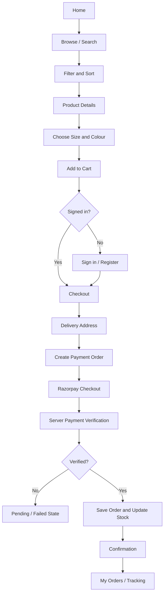
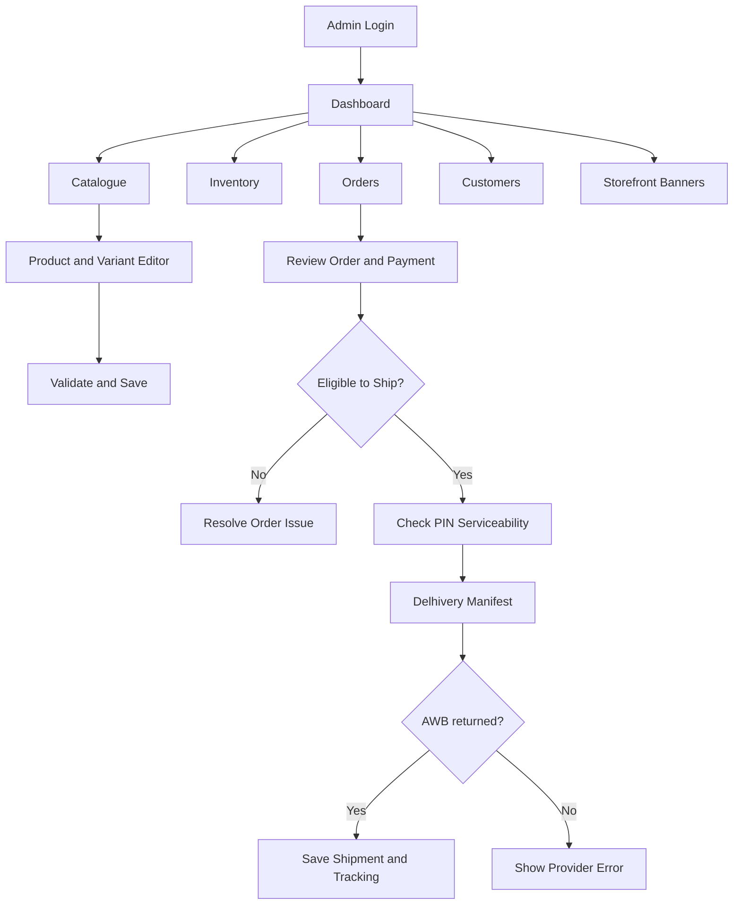
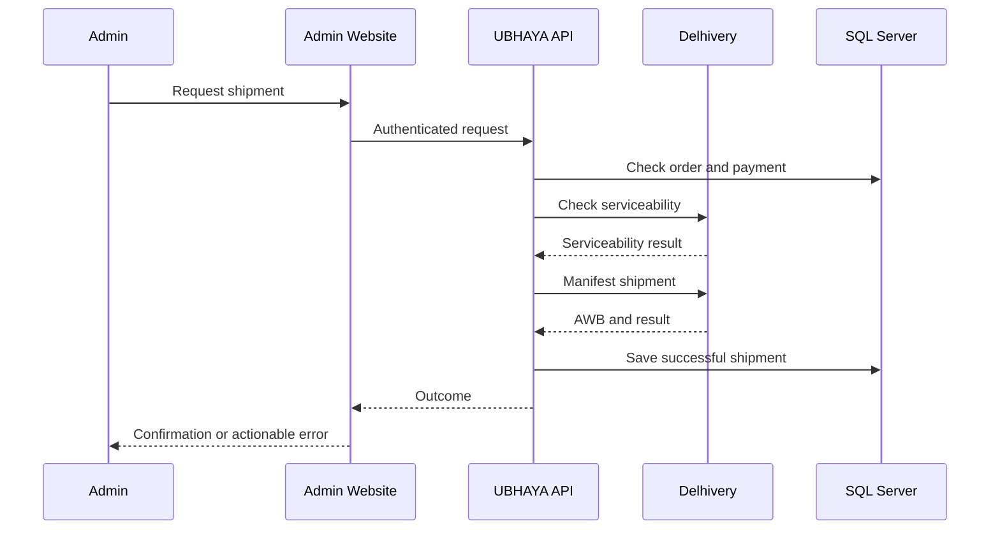

UBHAYA FASHIONS · EXPERIENCE DESIGNMap every customer journey
<h1>Application Flow</h1>

A visual guide to customer shopping, administrator operations, payment verification and order fulfilment.

<strong>Primary users</strong>Customers & administrators

<strong>Critical path</strong>Browse → Pay → Deliver

<strong>Integrations</strong>Razorpay · Delhivery

## <strong>01</strong> Customer journey

🔎<strong>01 · Discover</strong>
Home, category, search and product listing.

👗<strong>02 · Evaluate</strong>
Images, sizes, colours, price and availability.

🛒<strong>03 · Checkout</strong>
Cart, address validation and payment.

📦<strong>04 · Aftercare</strong>
Confirmation, order history and tracking.

## <strong>02</strong> Administrator journey

## <strong>03</strong> Payment lifecycle

| Stage | System action | Expected result |
|---|---|---|
| Create | Backend creates Razorpay order | Provider order ID saved |
| Pay | Customer completes checkout | Provider payment result |
| Verify | Backend validates signature/status | Trusted payment outcome |
| Commit | Persist payment and order state | Consistent database state |
| Notify | Confirmation workflow | Customer receives order update |
| Reconcile | Resolve uncertain provider outcome | No duplicate payment/order |

> [!IMPORTANT]
> A browser redirect is not proof of payment. Only server-side verification and trusted provider events can establish the paid state.

## <strong>04</strong> Shipment sequence

## <strong>05</strong> Key screens and routes

| Area | Typical route |
|---|---|
| Store home | `/` |
| Product listing | `/Products` |
| Admin login | `/Admin/Login` |
| Admin area | `/Admin` |
| Customer account | `/Account` |
| Customer orders | `/Orders` |
| Order tracking | `/Orders/Track/{id}` |

Confirm exact routes in the current controllers before relying on them.

## <strong>06</strong> UX states

⏳<strong>Loading</strong>
Show progress without blocking unrelated navigation.

🗂️<strong>Empty</strong>
Explain what is missing and provide a next action.

✓<strong>Success</strong>
Show only after server confirmation.

⚠️<strong>Error</strong>
Explain the issue and safe recovery path.

UBHAYA FASHIONS · Experience documentation · Keep journeys aligned with actual routes and state transitions.

