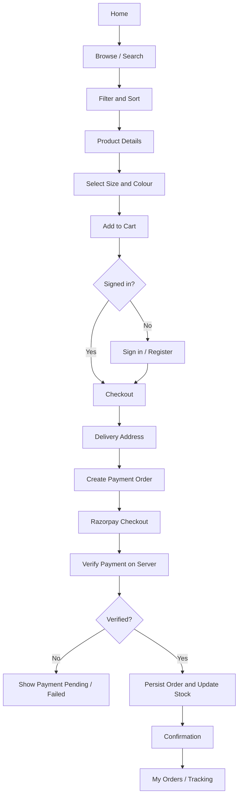
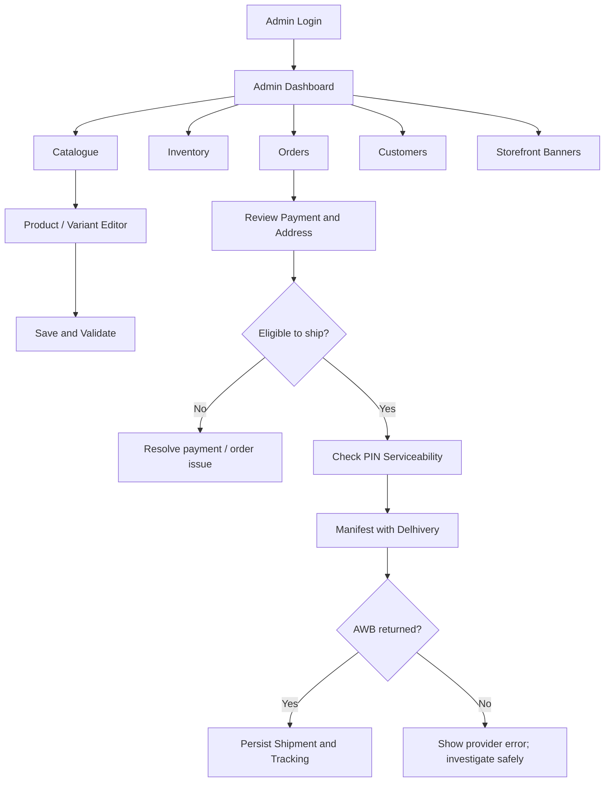
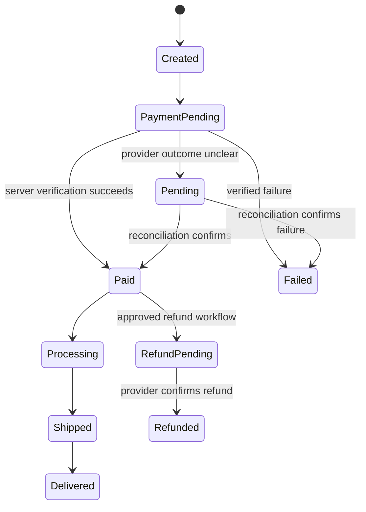
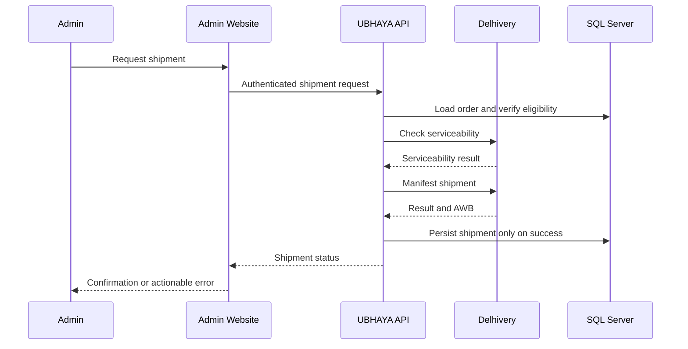

# Application Flow
### The customer journey and store operations

**A map of the key screens, transitions and system responsibilities.**

---

## 01 · Customer journey

### Journey details

| Step | Screen / action | Responsibility |
|---|---|---|
| Discover | Home, category, product listing | Render catalogue and navigation |
| Evaluate | Product detail | Show product media, variant options, stock and price |
| Select | Size, colour, quantity | Validate selected variant |
| Cart | Cart drawer/page | Re-check item availability and quantity |
| Checkout | Address and order summary | Validate address and authoritative totals |
| Pay | Razorpay Checkout | Complete provider payment interaction |
| Verify | Backend verification | Verify signature/provider state; protect against duplicate callbacks |
| Confirm | Order confirmation | Show only persisted order state |
| Aftercare | My Orders and tracking | Enforce customer ownership and show saved carrier status |

## 02 · Administrator journey

## 03 · Payment state flow

> [!IMPORTANT]
> Treat this as a conceptual state model. Use the actual enum/status values and transition rules implemented in the current code before changing production behaviour.

## 04 · Shipment flow

## 05 · Navigation map

| Area | Typical route |
|---|---|
| Store home | `/` |
| Product listing | `/Products` |
| Admin sign-in | `/Admin/Login` |
| Admin area | `/Admin` |
| Customer account | `/Account` |
| Customer orders | `/Orders` |
| Order tracking | `/Orders/Track/{id}` |

Routes can evolve; check the relevant MVC controller and route attributes before relying on a path.

## 06 · UX states every journey needs

- Initial loading and skeleton state where appropriate.
- Empty state with a useful next action.
- Inline validation close to the relevant field.
- Success feedback after server confirmation.
- Failure feedback that explains the next safe action.
- Retry behaviour that does not duplicate payments, orders or shipments.
- Mobile-friendly focus, keyboard navigation and touch targets.
