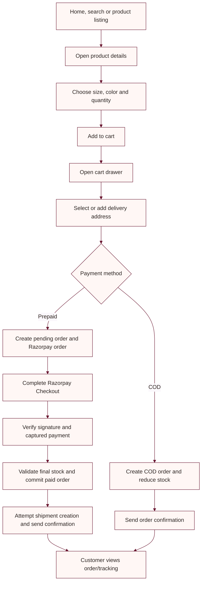
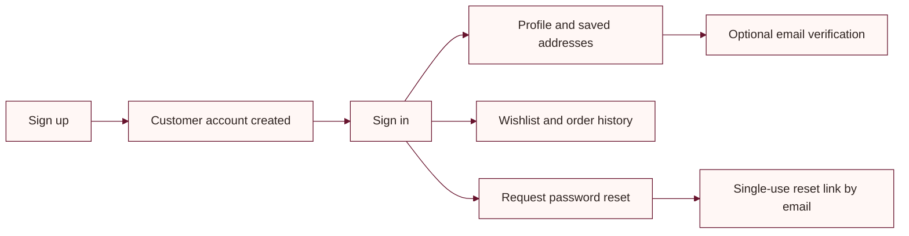

# Application flow

This page describes the current storefront and backend journeys. The frontend renders pages and calls the API; the API owns account, catalog, order, stock, and payment decisions.

## Browse to order

## Payment boundaries

- `POST /api/payments/create-order` recalculates price from stored product variants and saves a pending order before creating the Razorpay order.
- `POST /api/payments/verify` validates the Razorpay signature, checks the payment's captured status, amount, and order association, then finalizes the order and stock change.
- `POST /api/payment/razorpay/webhook` accepts signed Razorpay events and deduplicates event IDs.
- A captured payment with an inventory conflict requires manual review/refund handling. A carrier failure does not reverse a captured payment.
- The test-only `POST /api/payments/test-success` endpoint is separate and controlled by `PaymentTesting:Enabled`.

## Account journeys

Customers can sign in with the configured supported methods. Email verification is optional after the current storefront signup; a signed-in customer requests a six-digit code from the profile. See [email verification setup](../frontend/EMAIL_VERIFICATION_SETUP.md).

## Admin journey

Admin pages use a separate frontend cookie. Backend admin APIs require an Admin role. Account management is restricted to the fixed owner address `admin@ubhaya.com`. Provision the initial owner out of band; the application does not seed a default admin.
