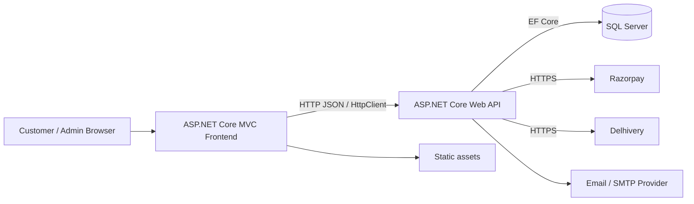
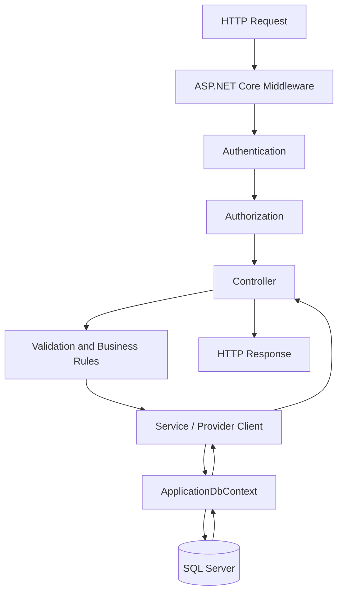

# System Architecture
### Boundaries, data flow and integration design

**A maintainable two-application architecture with one authoritative API.**

---

## 01 · System context

The repository contains two .NET 8 web projects:

| Project | Path | Responsibility |
|---|---|---|
| Storefront | `frontend/` | MVC controllers, Razor views, customer/admin web experience |
| API | `backend/` | Business rules, API controllers, authentication, persistence and provider integrations |
| Database | SQL Server | Durable application state |
| Tests | `tests/` | Automated verification |

The browser communicates with the MVC website. The website calls the API. The API is the only application layer that accesses the database through Entity Framework Core.

## 02 · Backend request path

Keep controllers focused on HTTP concerns. Put reusable business rules and provider communication in services. Use DTOs at API boundaries rather than exposing EF entities directly.

## 03 · Frontend request path

- MVC controllers receive browser requests and return views or redirects.
- Frontend services such as `ApiService` and `AdminApiService` centralize backend communication.
- Razor views render HTML; CSS and JavaScript provide progressive interaction.
- Authentication cookies belong to the website session.
- API tokens are used by the website when calling protected API endpoints.
- Do not put provider secrets or privileged API tokens in browser code.

## 04 · Key integration boundaries

| Integration | Owner | Security rule |
|---|---|---|
| SQL Server | Backend | Never connect from browser/frontend |
| Razorpay | Backend + browser checkout | Secret stays server-side; verify payment server-side |
| Delhivery | Backend | Token stays server-side; validate order eligibility |
| Email | Backend | Credentials stored in environment/secret store |
| File uploads | Backend storage | Validate files and persist outside ephemeral deployment folders |

## 05 · Runtime and local development

The root README documents the `start.sh` workflow:

- SQL Server: `localhost,1433`
- API: `http://localhost:5080`
- Website: `http://localhost:5000`

The Docker Compose layout publishes the website on port `5173` and API on port `5000`, with named volumes for database and upload data. Do not assume the container ports are the same as the local script ports.

## 06 · Configuration

Configuration is supplied through ASP.NET Core configuration providers. Use environment variables or a secret manager for deployment secrets.

Examples of settings documented by the repository:

- `ConnectionStrings:DefaultConnection`
- `Jwt:Key`, `Jwt:Issuer`, `Jwt:Audience`
- `FrontendUrl`
- `UploadsPath`
- `Razorpay:KeyId`, `Razorpay:KeySecret`
- Delhivery environment, token, client and pickup-location settings
- SMTP host, username and credentials

Use `backend/appsettings.example.json` as a placeholder reference, not as a production configuration file.

## 07 · Data and consistency

- Use database transactions for multi-step writes that must succeed or fail together.
- Enforce uniqueness and foreign-key constraints in the database.
- Make external side effects idempotent where provider capabilities permit.
- Do not hold a database transaction open while waiting on a slow external API unless the workflow explicitly requires it.
- Persist provider identifiers and raw status fields only when useful, with access and retention controls.
- Treat provider timeouts as unknown outcomes until reconciled; do not blindly repeat a charge or shipment request.

## 08 · File storage

Product images and other user-managed uploads must survive application redeployment. Configure a durable external folder or persistent volume using `UploadsPath`. Keep uploaded media out of the application publish directory when that directory is replaced during deployment. Back up uploads and database data independently.

## 09 · Architecture decision checklist

Before introducing a new service or dependency, answer:

1. Which project owns the responsibility?
2. Is the operation authoritative in the backend?
3. Does it cross a trust boundary?
4. How will failure, retries and duplicate requests behave?
5. How will the change be tested and observed?
6. Does deployment configuration or data migration need an update?
