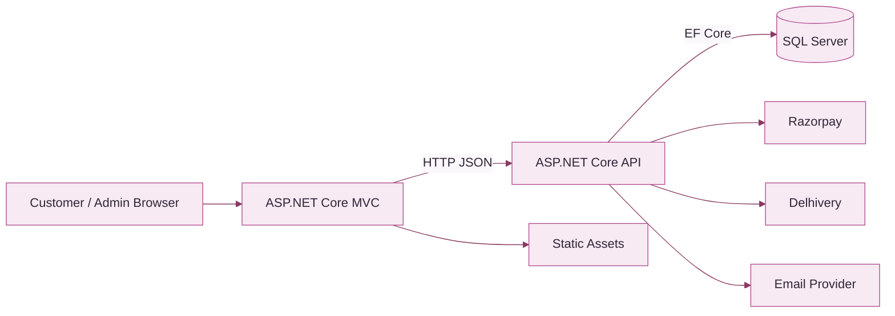
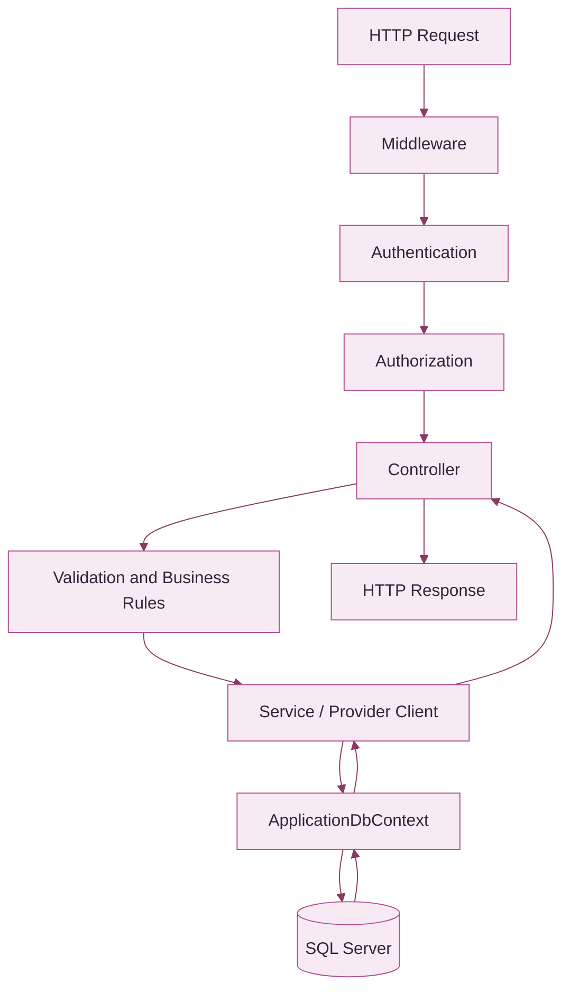

UBHAYA FASHIONS · ENGINEERINGUnderstand the system
<h1>System Architecture</h1>

How the storefront, API, database and external services work together while maintaining clear security and ownership boundaries.

<strong>Frontend</strong>ASP.NET Core MVC

<strong>Backend</strong>ASP.NET Core Web API

<strong>Persistence</strong>SQL Server · EF Core

## <strong>01</strong> System at a glance

🖥️<strong>Frontend</strong>
Razor views, MVC controllers, browser assets and customer/admin experience.

⚙️<strong>Backend API</strong>
Business rules, authentication, integrations and persistence.

🗄️<strong>Database</strong>
Durable application state managed through EF Core.

## <strong>02</strong> Repository structure

| Location | Responsibility |
|---|---|
| `frontend/` | MVC controllers, Razor views, services and static assets |
| `backend/` | API controllers, business services and configuration |
| `backend/Data/` | EF Core database context |
| `backend/Migrations/` | Versioned database changes |
| `tests/` | Automated regression tests |
| `docs/` | Product and engineering handbook |
| `docker-compose.yml` | Local container orchestration |

## <strong>03</strong> Backend request lifecycle

Controllers should handle HTTP concerns. Reusable business rules and provider communication belong in services. DTOs define API contracts.

## <strong>04</strong> Integration boundaries

| Integration | Responsible layer | Key protection |
|---|---|---|
| SQL Server | Backend | No browser database access |
| Razorpay | Backend + checkout UI | Secret server-side; verify signature |
| Delhivery | Backend | Token server-side; validate order eligibility |
| Email | Backend | Credentials in secure configuration |
| Upload storage | Backend | Validate files; use durable storage |

## <strong>05</strong> Local runtime

| Component | Local script URL / endpoint |
|---|---|
| Storefront | `http://localhost:5000` |
| API | `http://localhost:5080` |
| SQL Server | `localhost,1433` |

Docker Compose uses a different published port arrangement: website on `5173`, API on `5000`. Refer to the root README and compose file when starting services.

## <strong>06</strong> Configuration map

- `ConnectionStrings:DefaultConnection`
- `Jwt:Key`, `Jwt:Issuer`, `Jwt:Audience`
- `FrontendUrl` and `UploadsPath`
- `Razorpay:KeyId` and `Razorpay:KeySecret`
- Delhivery environment, token, client and pickup-location settings
- SMTP host, username and sender configuration

Use environment variables or a secret manager for production. Example settings are placeholders only.

## <strong>07</strong> Reliability and storage

🔁<strong>Idempotent operations</strong>
Protect payment callbacks, webhooks and shipment retries from duplicate side effects.

💾<strong>Durable uploads</strong>
Keep customer/product media outside replaceable publish folders and back it up separately.

Use transactions for related database writes. Treat provider timeouts as uncertain until reconciled. Avoid holding database transactions open across slow network calls without a deliberate design.

## <strong>08</strong> Architecture review checklist

- [ ] Responsibility belongs to the correct project.
- [ ] Backend remains authoritative for business rules.
- [ ] Trust boundaries and authorization are explicit.
- [ ] External failures and retries are safe.
- [ ] Configuration and secrets are documented securely.
- [ ] Tests and deployment steps are updated.

UBHAYA FASHIONS · Architecture handbook · Update when project boundaries or integrations change.

