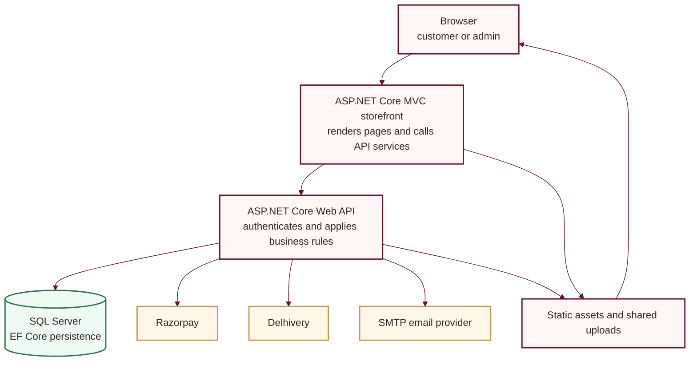
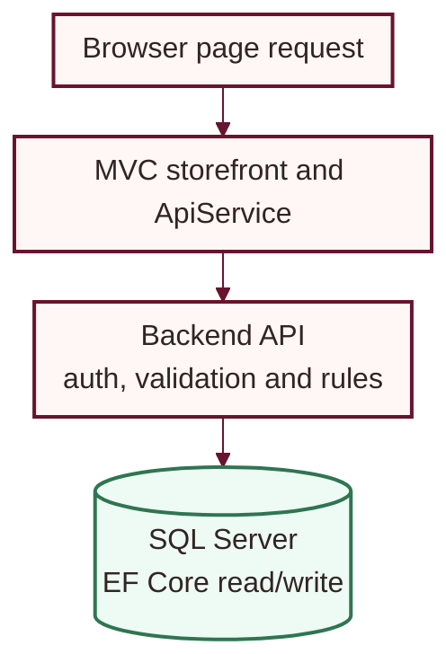

# Architecture

## System boundaries

- **Frontend:** `frontend/LadiesDressStore.Web.csproj`, ASP.NET Core MVC on .NET 8. Razor pages serve the storefront and admin UI. `ApiService` and `AdminApiService` call the backend.
- **Backend:** `backend/backend.csproj`, ASP.NET Core Web API on .NET 8. Controllers validate requests and delegate provider work to services.
- **Persistence:** SQL Server through EF Core in `backend/Data/ApplicationDbContext.cs`; migrations are in `backend/Migrations/`.
- **Providers:** Razorpay, Delhivery, SMTP, and optional social sign-in integrations are called from server-side code.
- **Media:** Both applications expose a shared persistent `UploadsPath` under `/uploads`.

## Local and Compose endpoints

| Service | Local launch profile | Docker Compose |
|---|---|---|
| Storefront | `https://localhost:5001` and `http://localhost:5000` | `http://localhost:5173` |
| API | `https://localhost:56738` and `http://localhost:56739` | `http://localhost:5000` |
| SQL Server | Configured local SQL Server | `localhost:1433` |

In local development, the frontend's `ApiBaseUrl` points to `https://localhost:56738/`. Inside Compose, the frontend uses the service address `http://api:5000/`. The host ports differ by environment.

## Request and authentication path

The API returns JSON to the MVC service layer, which renders the page. Protected API requests use JWT bearer authentication; the frontend uses distinct customer and admin cookies, and admin API authorization is enforced in the backend.

The API applies EF Core migrations during startup, so its configured database must be available. Production deployments should coordinate this startup behavior with their schema migration and rollback process.

## Static files

The storefront applies response compression to the static asset paths (`/css`, `/js`, `/images`, and `/uploads`). Static files receive cache headers; versioned assets get a long cache lifetime. Personalized HTML is not in the static-asset compression branch.
