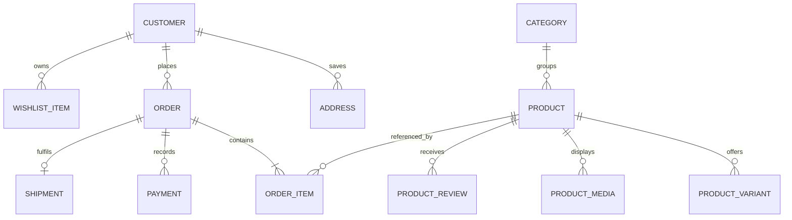

<div class="doc-hero">
<span class="doc-kicker">UBHAYA FASHIONS · DATA ENGINEERING</span><span class="doc-pill">Model data with confidence</span>
<h1>Backend Data Model</h1>
<p>A practical guide to persistence, domain relationships, migrations and the data integrity rules behind the store.</p>
<div class="doc-meta"><div><strong>Database</strong>SQL Server</div><div><strong>ORM</strong>Entity Framework Core</div><div><strong>Source of truth</strong>ApplicationDbContext</div></div>
</div>

## <strong>01</strong> Data ownership

The backend owns database access. The EF Core model is defined in `backend/Data/ApplicationDbContext.cs`, entity classes and versioned changes in `backend/Migrations/`.

## <strong>02</strong> Domain areas

<div class="doc-grid">
<div class="doc-card pink"><span class="ico">👤</span><strong>Identity</strong><p>Customer and administrator accounts, roles and authentication metadata.</p></div>
<div class="doc-card purple"><span class="ico">👗</span><strong>Catalogue</strong><p>Products, categories, product images and videos.</p></div>
<div class="doc-card blue"><span class="ico">🎨</span><strong>Variants</strong><p>Sizes, colours, price, discount and stock quantities.</p></div>
<div class="doc-card green"><span class="ico">🛒</span><strong>Commerce</strong><p>Orders, order items, payments and customer addresses.</p></div>
<div class="doc-card yellow"><span class="ico">🚚</span><strong>Fulfilment</strong><p>Carrier references, AWB and shipment tracking state.</p></div>
<div class="doc-card orange"><span class="ico">📣</span><strong>Storefront</strong><p>Homepage banner metadata and media references.</p></div>
</div>

## <strong>03</strong> Conceptual relationship map



> [!NOTE]
> This is a conceptual domain diagram, not a generated database schema. Verify exact table names, nullability, foreign keys and delete behaviours in the current EF model and migrations.

## <strong>04</strong> Persistence rules

| Concern | Standard |
|---|---|
| Money | Use `decimal`, never floating point |
| Relationships | Explicit foreign keys and delete behaviours |
| Migrations | Version all schema changes with EF Core |
| Indexes | Add based on query patterns and uniqueness |
| Time | Store consistently; display in user timezone |
| Media | Store files durably; persist references/metadata |
| History | Preserve order and payment history appropriately |

## <strong>05</strong> Migration workflow

```bash
cd backend
dotnet ef migrations add <DescriptiveMigrationName>
dotnet ef database update
```

<div class="doc-grid four">
<div class="doc-card pink"><span class="ico">1️⃣</span><strong>Generate</strong><p>Create migration from model changes.</p></div>
<div class="doc-card purple"><span class="ico">2️⃣</span><strong>Review</strong><p>Inspect generated SQL and destructive changes.</p></div>
<div class="doc-card blue"><span class="ico">3️⃣</span><strong>Backup</strong><p>Take and verify a database backup.</p></div>
<div class="doc-card green"><span class="ico">4️⃣</span><strong>Apply</strong><p>Deploy and validate critical data paths.</p></div>
</div>

## <strong>06</strong> Data protection

- Never add real customer information or secrets to seed data.
- Restrict production database and backup access.
- Avoid logging full addresses, phone numbers and payment payloads.
- Define retention and deletion rules.
- Use synthetic data in automated tests.

<div class="doc-footer">UBHAYA FASHIONS · Data handbook · Keep this aligned with EF Core entities and migrations.</div>
