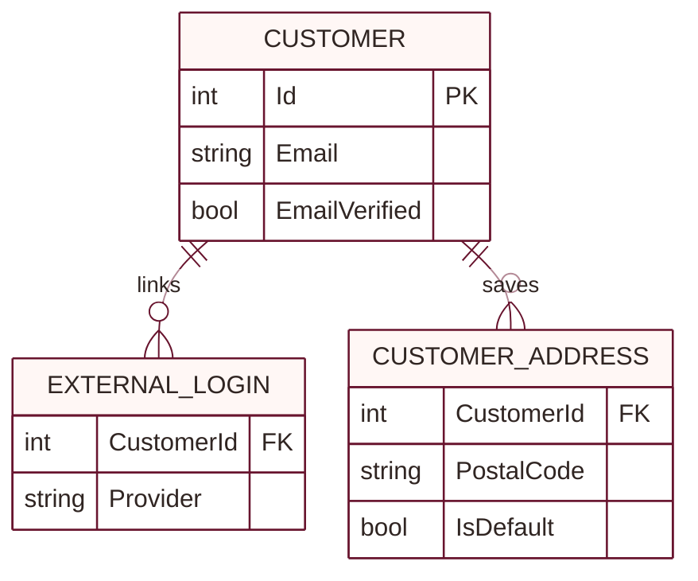
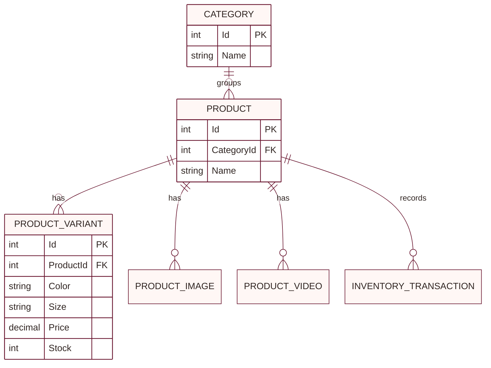
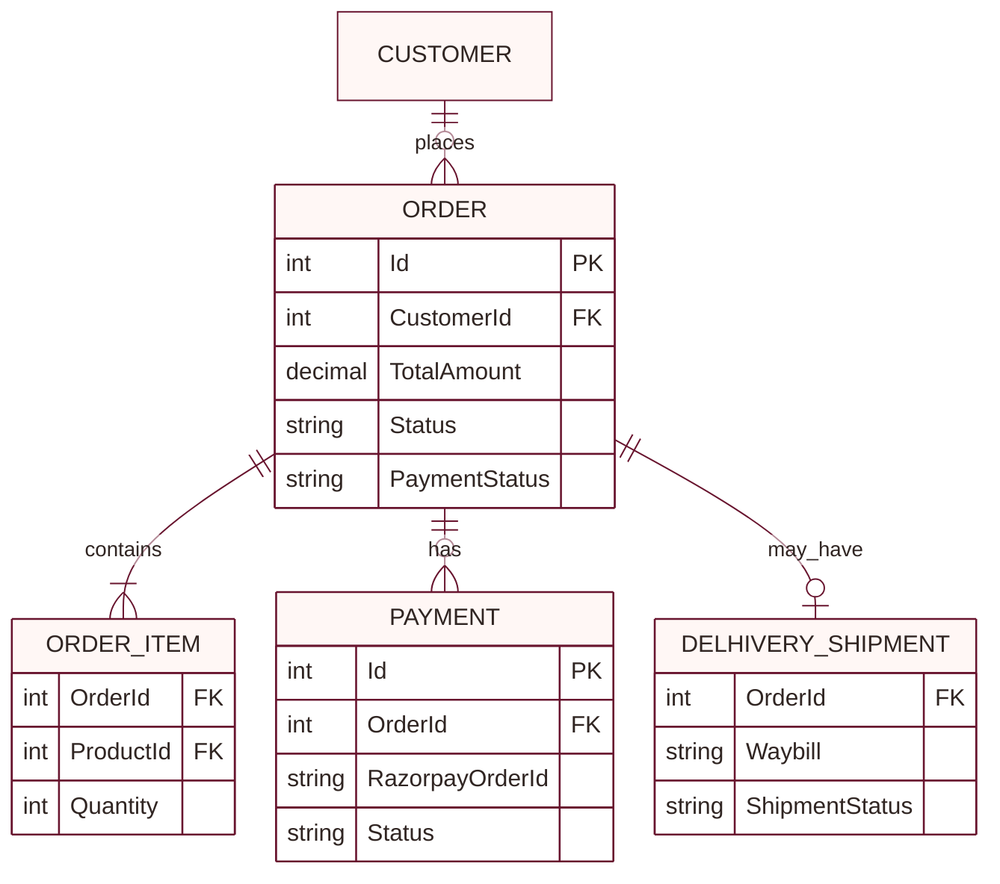
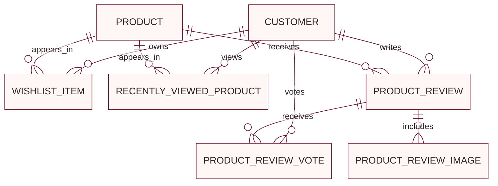
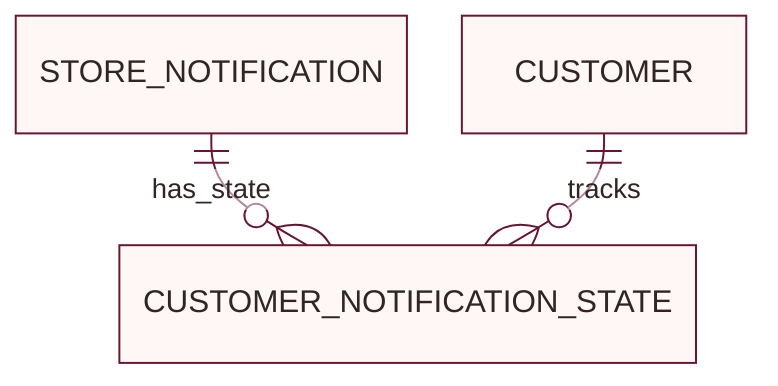

# Backend schema

The EF Core source of truth is `backend/Data/ApplicationDbContext.cs`, the model configuration, and the migrations in `backend/Migrations/`. These simplified diagrams are split by domain so their entity names and relationships remain readable. They omit most columns, indexes, and some standalone support tables.

## Core relationship diagram

### Accounts

### Catalog and inventory

### Orders and payments

### Customer activity

### Notifications

## Model groups

- **Accounts:** `Customers`, `PendingSignups`, `ExternalLogins`, `AdminUsers`, `CustomerAddresses`
- **Catalog:** `Categories`, `Products`, `ProductVariants`, `ProductImages`, `ProductVideos`
- **Commerce:** `Orders`, `OrderItems`, `Payments`, `RazorpayWebhookEvents`, `DelhiveryShipments`, `InventoryTransactions`
- **Customer activity:** `WishlistItems`, `RecentlyViewedProducts`, `ProductReviews`, `ProductReviewImages`, `ProductReviewVotes`
- **Notifications:** `StoreNotification` records (DbSet exposed as `Notifications`) and `CustomerNotificationStates`

## Important constraints

- Product variant identity is unique by `(ProductId, Color, Size)`.
- Razorpay order IDs and webhook event IDs are unique; a non-null Razorpay payment ID is unique.
- An order has at most one Delhivery shipment record.
- A customer can review a product once; review votes are unique per customer and review.
- Customer notification state uses the composite key `(CustomerId, NotificationId)`.
- Product categories are protected from deletion while referenced. Deleting a product clears its optional product link from a store notification.

Migrations are applied automatically at API startup. For a deployment that manages schema changes separately, use `dotnet ef database update --project backend/backend.csproj --startup-project backend/backend.csproj` and coordinate the operation with the database backup and rollback plan.
