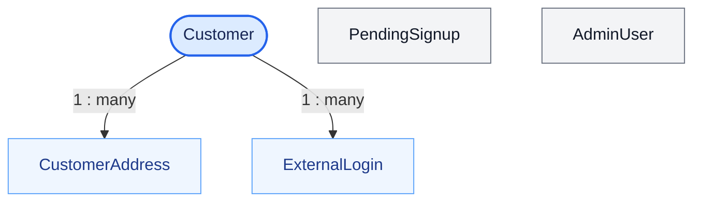
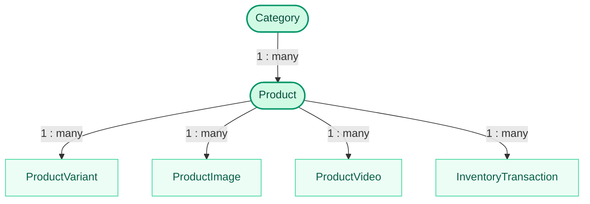
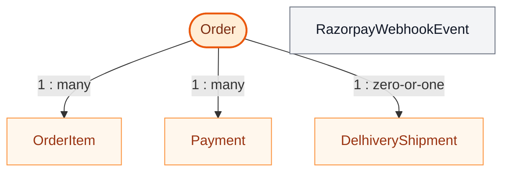
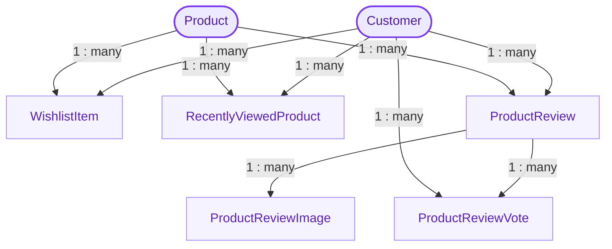
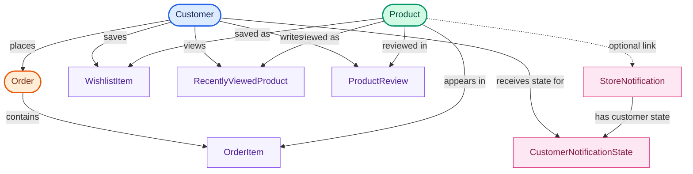

# Backend schema

The EF Core source of truth is `backend/Data/ApplicationDbContext.cs`, the model configuration, and the migrations in `backend/Migrations/`. These diagrams are simplified views of the current model. They focus on entity relationships and omit most scalar columns and indexes.

## Core relationship overview

The schema is split into small diagrams so entity names, cardinalities, and relationship lines remain readable in GitHub and common Markdown previews. Each domain has its own colour. The final diagram shows the links that cross domain boundaries.

### 1. Accounts



### 2. Catalog and inventory



### 3. Orders and payments



### 4. Customer activity



### 5. Notifications

```mermaid
flowchart TB
    N(["StoreNotification"])
    S["CustomerNotificationState"]
    P["Product (optional link)"]
    C["Customer"]

    N -->|"1 : many"| S
    C -->|"1 : many"| S
    P -.->|"optional product reference"| N

    classDef notification fill:#FCE7F3,stroke:#DB2777,color:#831843,stroke-width:2px;
    classDef related fill:#FDF2F8,stroke:#F472B6,color:#9D174D;
    N classDef notification;
    class S,P,C related;
```

### 6. Cross-domain relationships

This view contains only the main links between business areas. Refer to the domain diagrams above for each area's internal relationships.



**Relationship notes**

- `PendingSignup`, `AdminUser`, and `RazorpayWebhookEvent` are independent records in the current EF Core model; no entity foreign-key relationship is drawn for them.
- `DelhiveryShipment` has a unique `OrderId`, so an order can have at most one shipment record.
- Customer activity records connect customers and products through their own entity rows.
- A store notification may optionally reference a product; deleting that product clears the notification link.
- The diagrams show principal foreign-key relationships, not every scalar property or index.

## Model groups

- **Accounts:** `Customers`, `PendingSignups`, `ExternalLogins`, `AdminUsers`, `CustomerAddresses`
- **Catalog:** `Categories`, `Products`, `ProductVariants`, `ProductImages`, `ProductVideos`
- **Commerce:** `Orders`, `OrderItems`, `Payments`, `RazorpayWebhookEvents`, `DelhiveryShipments`, `InventoryTransactions`
- **Customer activity:** `WishlistItems`, `RecentlyViewedProducts`, `ProductReviews`, `ProductReviewImages`, `ProductReviewVotes`
- **Notifications:** `StoreNotification` records (DbSet exposed as `Notifications`) and `CustomerNotificationStates`

## Important constraints

- Product variant identity is unique by `(ProductId, Color, Size)`.
- Razorpay order IDs and webhook event IDs are unique; a non-null Razorpay payment ID is unique.
- An order has at most one Delhivery shipment record.
- A customer can review a product once; review votes are unique per customer and review.
- Customer notification state uses the composite key `(CustomerId, NotificationId)`.
- Product categories are protected from deletion while referenced. Deleting a product clears its optional product link from a store notification.

Migrations are applied automatically at API startup. For a deployment that manages schema changes separately, use `dotnet ef database update --project backend/backend.csproj --startup-project backend/backend.csproj` and coordinate the operation with the database backup and rollback plan.
