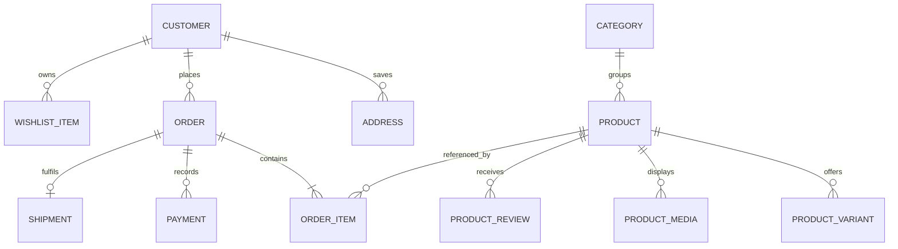

<div align="center">

# Backend Data Model
### Persistence guide and relationship map

**A developer-oriented guide to the database boundary and schema evolution.**

</div>

---

## 01 · Source of truth

The EF Core model is defined in:

- `backend/Data/ApplicationDbContext.cs`
- Entity/model classes in the backend project
- Versioned schema changes in `backend/Migrations/`

The database is SQL Server. The API owns all database access. This document intentionally describes domain areas rather than guessing every column or relationship; inspect the entity and migration definitions before writing a migration.

## 02 · Domain areas

| Domain | Responsibility | Examples of data |
|---|---|---|
| Identity | Customer and administrator access | Accounts, credentials metadata, roles/tokens |
| Catalogue | Product discovery | Products, categories, product media |
| Variants | Sellable options | Sizes, colours, prices, stock |
| Customer | Shopping preferences | Addresses, wishlist, recently viewed |
| Commerce | Purchase lifecycle | Orders, order items, payments |
| Fulfilment | Carrier workflow | Shipment identifiers, AWB and tracking state |
| Storefront content | Homepage merchandising | Banner metadata and media references |
| Operations | Support and diagnostics | Error logs and operational records |

## 03 · Conceptual relationships



> [!NOTE]
> This ER diagram is a domain-level illustration, not a generated schema diagram. Confirm exact table names, cardinalities, nullable relationships and delete behaviours from the current EF model and migrations.

## 04 · Persistence rules

- Use EF Core migrations for schema changes; do not manually change only one environment.
- Review generated migration SQL for destructive or locking operations.
- Preserve historical order-item price and product description snapshots where the model supports them.
- Use decimal types for money; never use floating-point types for financial amounts.
- Store timestamps consistently and display them in the user's expected timezone.
- Add indexes based on measured query patterns and uniqueness requirements.
- Define delete behaviour deliberately for orders, payments, customers and product history.
- Keep uploaded binary files in durable file storage; store their references/metadata in SQL Server.

## 05 · Migration workflow

```bash
cd backend
dotnet ef migrations add <DescriptiveMigrationName>
dotnet ef database update
```

Before release:

1. Confirm the correct connection string/environment.
2. Review the migration and generated SQL.
3. Take a verified database backup.
4. Test upgrade against a recent non-production copy.
5. Confirm rollback/recovery strategy.
6. Apply the migration through the approved deployment process.
7. Verify application health and critical read/write paths.

## 06 · Data protection

- Never add real customer records, passwords, access tokens or payment secrets to seed data.
- Restrict access to production databases and backups.
- Avoid logging full addresses, phone numbers, payment payloads or authentication headers.
- Define retention and deletion rules for account and operational data.
- Keep test fixtures synthetic.
