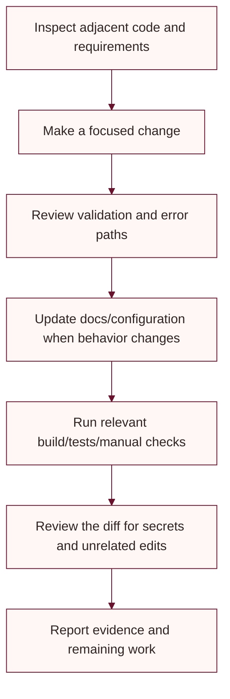

# Code style

Use the conventions of the surrounding code and keep changes focused. The projects target .NET 8 with nullable reference types enabled.

## C# and API

- Use async I/O and pass cancellation tokens where the surrounding API supports them.
- Keep controllers focused; put reusable provider or domain work in services.
- Use DTOs for API request and response contracts rather than exposing EF entities.
- Use `decimal` for money and validate business values on the backend.
- Prefer dependency injection and avoid blocking calls such as `.Result` or `.Wait()` in request paths.
- Keep customer ownership and admin role checks on the server.
- Return useful HTTP status codes without exposing secrets or unnecessary internals.

## Naming

| Item | Convention | Example |
|---|---|---|
| Types and public members | PascalCase | `OrdersController` |
| Interfaces | `I` plus PascalCase | `IEmailService` |
| Methods | PascalCase with async suffix for Tasks | `CreateShipmentAsync` |
| Locals and parameters | camelCase | `orderId` |
| CSS classes | kebab-case | `.product-card__price` |
| Tests | Describe behavior and condition | `PriceCeiling_UsesFallbackWhenEmpty` |

## Frontend and accessibility

Use semantic HTML and labels, preserve keyboard operation and visible focus, and provide accessible names for icon-only controls. Keep JavaScript modular and avoid duplicate event handlers. Keep CSS responsive and avoid introducing horizontal overflow at narrow widths.

## Contribution workflow



From the repository root, the common validation commands are:

```powershell
dotnet build LadiesDressStore.sln
dotnet test tests/UbhayaFashions.Tests/UbhayaFashions.Tests.csproj
```

The current test project is small; do not infer broad integration or browser coverage from these commands.
