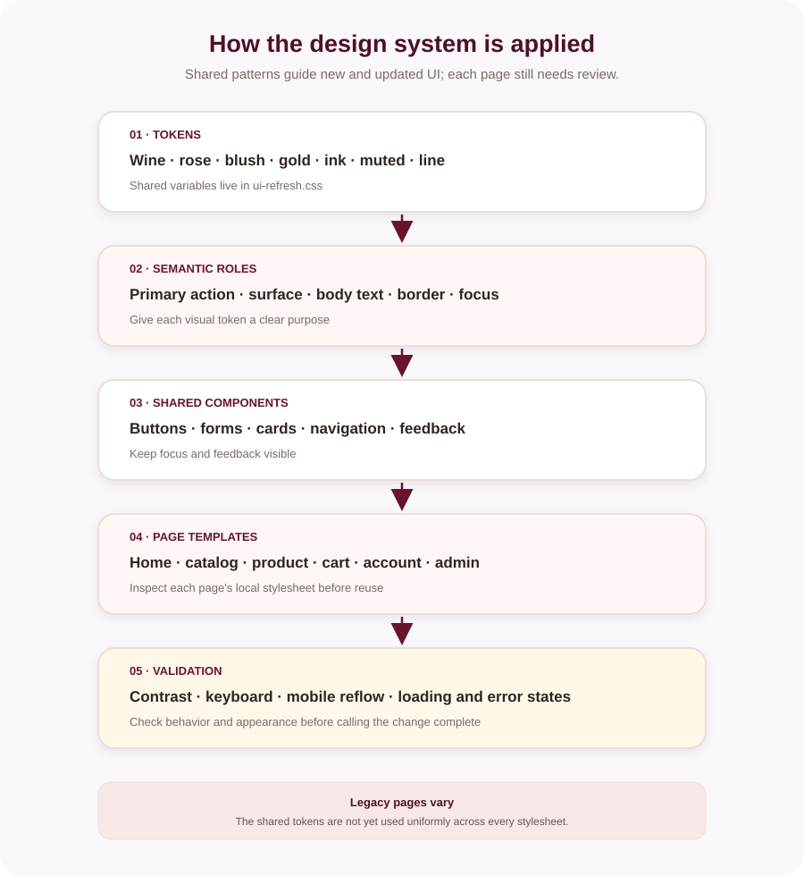

# Design system

The storefront uses a warm fashion palette with deep wine accents, blush surfaces, gold highlights, dark brown text, and muted supporting text. Styles are spread across page stylesheets; the shared refresh tokens are in `frontend/wwwroot/css/pages/shared/ui-refresh.css`.

## Shared tokens

| Token | Value | Use |
|---|---|---|
| `--ui-wine` | `#68142e` | Primary brand/action |
| `--ui-wine-deep` | `#4f1025` | Deep brand accent |
| `--ui-rose` | `#a84a61` | Secondary accent |
| `--ui-blush` | `#f8e9e9` | Soft surface |
| `--ui-blush-light` | `#fff7f5` | Light surface |
| `--ui-gold` | `#c69a45` | Accent/detail |
| `--ui-ink` | `#302522` | Main text |
| `--ui-muted` | `#786a68` | Secondary text |
| `--ui-line` | `#eadedb` | Borders/dividers |

These are shared tokens, not a guarantee that every legacy page currently uses them. Review a page's local stylesheet before changing its visual rules.

## Type and layout

The storefront primarily uses Arial for interface text and Georgia for selected editorial headings. Keep body text readable, preserve hierarchy, and test both narrow mobile and desktop layouts. Components should not depend on hover for essential actions.

## Interaction states



```mermaid
%%{init: {"theme":"base","themeVariables":{"background":"#fbf8fc","primaryColor":"#fff7f5","primaryTextColor":"#302522","primaryBorderColor":"#68142e","lineColor":"#68142e","edgeLabelBackground":"#fbf8fc","actorBkg":"#fff7f5","actorBorder":"#68142e","actorTextColor":"#302522","actorLineColor":"#68142e","signalColor":"#68142e","signalTextColor":"#302522","labelBoxBkgColor":"#fff7f5","labelBoxBorderColor":"#68142e","labelTextColor":"#302522","loopTextColor":"#302522","noteBkgColor":"#fff8e9","noteBorderColor":"#c69a45","noteTextColor":"#302522","activationBkgColor":"#f8e9e9","activationBorderColor":"#68142e","sequenceNumberColor":"#302522"}}}%%
stateDiagram-v2
    [*] --> Default
    Default --> Hover: Pointer enters
    Default --> Focus: Keyboard focus
    Default --> Loading: Action starts
    Loading --> Success: Request succeeds
    Loading --> Error: Request fails
    Success --> Default: Continue
    Error --> Default: Retry
```

Every interactive control should have a visible keyboard focus state and a clear loading/success/error response where the action is asynchronous. Use labels and meaningful alternative text for content images; use empty alt text only for decorative images.
