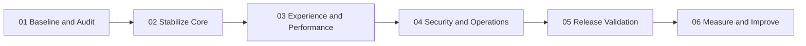

# Implementation Plan
### From stable foundations to continuous improvement

**A phased delivery plan with concrete outcomes and release gates.**

---

## 01 · Delivery approach

Deliver in small increments. Protect the working storefront and revenue-critical flows while improving reliability, performance, security and maintainability.

## 02 · Workstreams

| Workstream | Outcome | Priority |
|---|---|---|
| Product experience | Clear, polished and responsive shopping journey | High |
| Performance | Faster page loads and stable Core Web Vitals | High |
| Checkout reliability | Verified, idempotent payment-to-order flow | Critical |
| Fulfilment | Safe shipment creation and useful tracking | High |
| Security | Strong authorization, secrets and upload controls | Critical |
| Quality | Automated regression coverage for business rules | High |
| Operations | Durable uploads, backups, logs and recovery | Critical |
| Documentation | Current, useful engineering handbook | Medium |

## 03 · Phases and milestones

### Phase 1 — Baseline and audit

**Deliverables**
- Confirm current branch, build state and deployment configuration.
- Map customer and admin critical journeys.
- Capture baseline PageSpeed/Lighthouse metrics for home and product pages.
- Inventory configuration, secrets, storage and database backup procedures.
- Identify untested payment, shipping and authorization paths.

**Exit gate:** agreed baseline, prioritized defects and a reproducible local build.

### Phase 2 — Stabilize core workflows

**Deliverables**
- Verify account and password-reset flows.
- Verify cart, checkout and server-side pricing/stock checks.
- Verify Razorpay signature and webhook handling.
- Verify order persistence and inventory consistency.
- Verify shipment eligibility, provider failures and duplicate protection.

**Exit gate:** critical workflows pass automated tests and sandbox smoke tests.

### Phase 3 — Experience and performance

**Deliverables**
- Improve responsive navigation and product-card consistency.
- Optimize image formats, dimensions, responsive sources and loading priority.
- Reduce unnecessary frontend/API calls and expensive database queries.
- Improve loading, empty and error states.
- Re-test home, listing and detail pages under consistent PageSpeed conditions.

**Exit gate:** no major visual regressions; measured performance improves or trade-offs are documented.

### Phase 4 — Security and operations

**Deliverables**
- Review authentication and authorization boundaries.
- Move all production secrets to managed configuration.
- Verify durable upload storage and independent backups.
- Review logs for sensitive data.
- Validate database restore and deployment rollback procedures.

**Exit gate:** operational recovery and security checklist completed.

### Phase 5 — Release validation

**Deliverables**
- Build and automated test run.
- Database migration review and backup.
- Production configuration verification.
- Mobile/desktop smoke test.
- Payment and shipment readiness confirmation.
- Monitoring and support handover.

**Exit gate:** release owner approves all critical checks.

### Phase 6 — Measure and improve

Review real usage, conversion, support issues, provider reliability and performance. Prioritize changes from evidence rather than assumptions.

## 04 · Prioritization model

- **P0 — Critical:** payment integrity, data loss, security exposure, production outage.
- **P1 — High:** checkout blockers, order/stock inconsistency, major mobile usability defects.
- **P2 — Medium:** performance opportunities, admin workflow improvements, accessibility gaps.
- **P3 — Later:** cosmetic polish and non-essential enhancements.

## 05 · Change tracking

For each milestone, record:

| Field | Record |
|---|---|
| Owner | Responsible contributor |
| Status | Not started / In progress / Blocked / Done |
| Evidence | PR, test run, metric or deployment reference |
| Risks | Known dependencies and rollback plan |
| Decision | Approved scope or trade-off |

Do not mark a phase complete based only on code being committed. Require validation evidence.
