UBHAYA FASHIONS · DELIVERY ROADMAPTurn priorities into progress
<h1>Implementation Plan</h1>

A phased delivery roadmap to stabilize core commerce, improve the shopping experience and prepare reliable releases.

<strong>Approach</strong>Incremental delivery

<strong>Focus</strong>Quality · Security · UX

<strong>Release rule</strong>Evidence before done

## <strong>01</strong> Delivery strategy

Protect the working storefront and revenue-critical workflows. Deliver small changes with clear validation, rollback awareness and measurable outcomes.

## <strong>02</strong> Main workstreams

🛍️<strong>Product experience</strong>
Polished responsive shopping and admin journeys.

⚡<strong>Performance</strong>
Optimized assets, rendering and API/database usage.

💳<strong>Checkout reliability</strong>
Verified and idempotent payment-to-order flow.

🚚<strong>Fulfilment</strong>
Safe shipment creation and clear tracking.

🛡️<strong>Security</strong>
Authorization, secrets and upload safeguards.

🧪<strong>Quality</strong>
Regression tests and operational readiness.

## <strong>03</strong> Milestone roadmap

## <strong>04</strong> Phase details

```mermaid
%%{init: {"theme":"base","themeVariables":{"background":"#fbf8fc","primaryColor":"#f7eaf3","primaryTextColor":"#302638","primaryBorderColor":"#b34e91","lineColor":"#8b3a62","secondaryColor":"#eff7ff","tertiaryColor":"#fff8e9","mainBkg":"#f7eaf3","nodeBorder":"#b34e91","clusterBkg":"#f5f0ff","clusterBorder":"#c9b5df","titleColor":"#56264e","edgeLabelBackground":"#fbf8fc","fontFamily":"Segoe UI, Arial, sans-serif"}}}%%
flowchart LR
 A[01 Baseline Audit] --> B[02 Stabilize Core]
 B --> C[03 UX and Performance]
 C --> D[04 Security and Operations]
 D --> E[05 Release Validation]
 E --> F[06 Measure and Improve]
```

| Phase | Focus | Deliverables | Exit gate |
|---|---|---|---|
| 01 | Baseline audit | Build, journey, performance and configuration review | Reproducible baseline |
| 02 | Core workflows | Identity, cart, checkout, payment, inventory and shipping tests | Critical paths validated |
| 03 | Experience | Responsive UI, images, API and query optimization | No major regressions; metrics reviewed |
| 04 | Security/operations | Secrets, access, uploads, backups and recovery | Operational checks complete |
| 05 | Release | Build, tests, migration, smoke tests and monitoring | Release owner approval |
| 06 | Improve | Analytics, support issues and performance review | Evidence-based backlog |

## <strong>05</strong> Prioritization

🔴<strong>P0 · Critical</strong>
Payment integrity, data loss, security exposure and production outage.

🟠<strong>P1 · High</strong>
Checkout blockers, order/stock inconsistency and major mobile defects.

🔵<strong>P2 · Medium</strong>
Performance improvements, admin workflow and accessibility gaps.

⚪<strong>P3 · Later</strong>
Cosmetic polish and non-essential enhancements.

## <strong>06</strong> Milestone tracking

| Field | What to record |
|---|---|
| Owner | Responsible contributor |
| Status | Not started / In progress / Blocked / Done |
| Evidence | Pull request, test run, metric or deployment reference |
| Risks | Dependencies, impact and rollback plan |
| Decision | Approved scope and trade-offs |

## <strong>07</strong> Definition of milestone complete

- [ ] Implementation merged.
- [ ] Relevant automated tests pass.
- [ ] Manual acceptance completed where needed.
- [ ] Performance/security impact reviewed.
- [ ] Documentation and configuration updated.
- [ ] Deployment and rollback implications understood.
- [ ] Evidence attached to the milestone.

UBHAYA FASHIONS · Delivery roadmap · Update status only when validation evidence exists.

