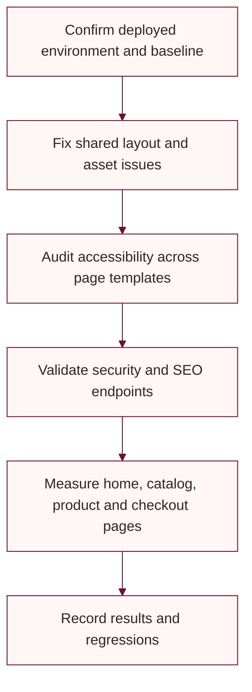

# Implementation status and follow-up plan

This document summarizes implementation visible in the repository and the remaining verification work. It is not a release or deployment report.

## Current implementation map

| Area | Present in source | Follow-up evidence |
|---|---|---|
| Storefront and API | ASP.NET Core MVC and Web API projects target .NET 8 | Build both projects after code changes |
| Catalog and checkout | Product variants, saved addresses, COD and Razorpay prepaid flows | Walk through representative product and checkout journeys |
| Payments and shipping | Razorpay verification/webhook handling and Delhivery shipment records | Use provider test environments and inspect logs/orders |
| SEO endpoints | `robots.txt`, `llms.txt`, generated `/sitemap.xml`, Google product feed | Fetch each public endpoint and validate its output on the deployed host |
| Static delivery | Static asset compression, cache headers, response headers | Re-run PageSpeed Insights on the deployed pages and record device, URL, date, and scores |
| Accessibility | Semantic templates and interactive components exist across the storefront | Complete keyboard, screen-reader, contrast, and automated audits across page templates |
| Security | JWT validation, separate frontend cookies, antiforgery and response headers are present; the API CORS policy currently allows any origin | Restrict CORS, then review HTTPS deployment, cookie settings, secret rotation, and authorization coverage |
| Tests | Product catalog unit tests are present | Add focused tests for uncovered order, payment, SEO, and accessibility behavior |

Do not record an audit as passed until its evidence has been collected. PageSpeed results vary with URL, device profile, network, cache, and deployment state.

## Recommended sequence

## Source-of-truth files

- Project behavior: `frontend/Controllers/`, `frontend/Views/`, `backend/Controllers/`, and `backend/Services/`
- Database: `backend/Data/ApplicationDbContext.cs` and `backend/Migrations/`
- Local ports: `frontend/Properties/launchSettings.json` and `backend/Properties/launchSettings.json`
- Static asset performance: `frontend/Program.cs` and `frontend/wwwroot/`
- Tests: `tests/UbhayaFashions.Tests/`
