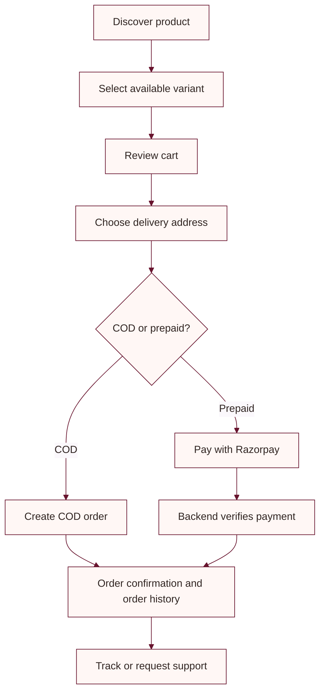

# Product requirements

## Product summary

UBHAYA FASHIONS is an online storefront for Jaipuri-style clothing. Customers browse the catalog, select product variants, manage delivery addresses, place orders, and review order status. Administrators manage catalog, inventory, orders, and shipping operations.

## Users

| User | Main needs |
|---|---|
| Shopper | Browse products, choose size/color, check out, receive order updates |
| Signed-in customer | Manage profile and addresses, wishlist, orders, email verification |
| Administrator | Manage products, stock, orders, payments, and carrier shipment actions |
| Store owner | Manage administrator accounts and operational access |

## Current product capabilities

- Home, catalog, search, product detail, and category browsing
- Product variants with size, color, pricing, discount, and stock
- Customer sign-up/sign-in and supported external sign-in providers when configured
- Saved addresses and location/address lookup
- COD and Razorpay prepaid checkout
- Order history, cancellation/tracking routes, and order confirmation emails
- Wishlist, recently viewed products, reviews, and customer notifications
- Admin catalog, inventory, order, and Delhivery workflows
- Public robots, sitemap, LLM guidance, and Google product feed endpoints

## Commerce requirements

1. The backend owns product price, stock, order totals, and payment state.
2. A prepaid order is marked paid only after backend verification of the provider signature and captured payment.
3. Payment finalization and stock changes must be idempotent across verification retries and webhook delivery.
4. Shipping provider failure must remain visible for operator follow-up and must not silently reverse a captured payment.
5. Customer data and admin actions must be scoped and authorized server-side.

## Customer journey

## Product-quality requirements

- Pages should remain usable on mobile and desktop.
- Core actions should be available with keyboard and assistive technology.
- Public pages should expose accurate metadata and crawlable sitemap/feed data.
- Performance and PageSpeed claims must cite a fresh measurement on the deployed URL.
- Agentic browsing guidance must describe public pages and avoid exposing private account or checkout data.

This document describes the application represented by the current source. It does not promise external provider availability, a specific PageSpeed score, or a completed accessibility certification.
