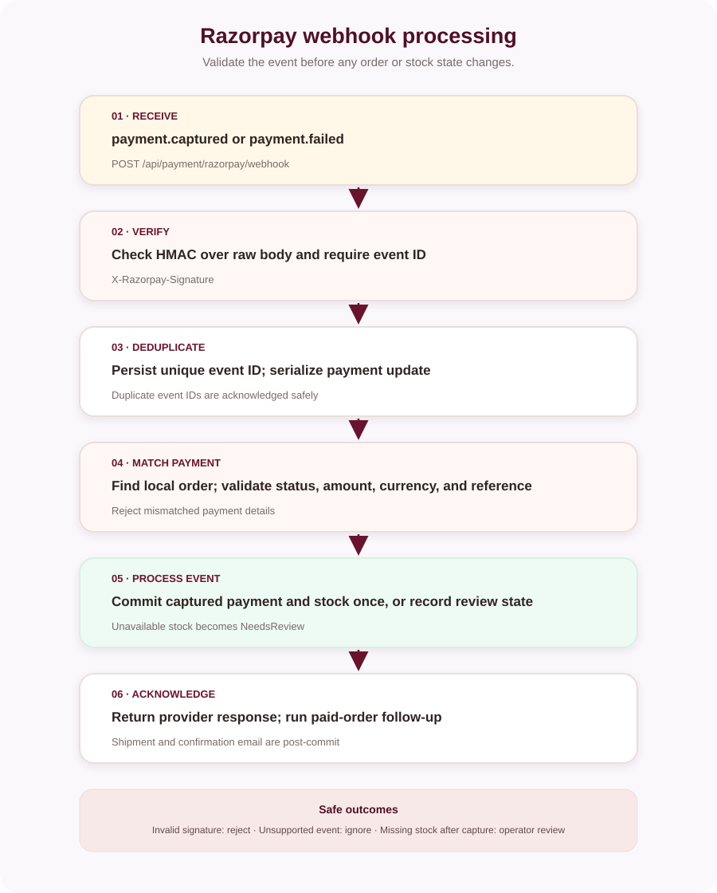

# Razorpay webhook setup

The backend exposes a public webhook endpoint that verifies Razorpay's signature, validates captured-payment details, and records provider event IDs for idempotent processing.

## Endpoint and settings

Configure the Razorpay webhook URL as:

```text
https://<public-site-host>/api/payment/razorpay/webhook
```

Subscribe to `payment.captured` and `payment.failed`. Configure the same webhook secret in the backend setting `Razorpay:WebhookSecret` (environment variable `Razorpay__WebhookSecret`). Keep it out of frontend configuration and source control.

## Event handling



The endpoint validates the raw-body HMAC using `X-Razorpay-Signature` and requires the `x-razorpay-event-id` header. The event ID has a unique database index, which makes repeated deliveries detectable. Unsupported event types are acknowledged and ignored.

For `payment.captured`, the backend checks captured status, expected amount, currency, and local Razorpay order ID before committing the paid order and stock change. If inventory is no longer available after capture, the event is marked `NeedsReview`; an operator must handle the order/refund. Shipment and confirmation follow-up happens after successful payment processing.

## Operations

1. Add the webhook in the correct Razorpay test or live account.
2. Use the matching secret in the backend environment.
3. Send provider test events and confirm a successful response in the provider dashboard and application logs.
4. Confirm a captured event changes the matching order once and creates the expected stock transaction.
5. Confirm duplicate delivery does not deduct stock twice.
6. Monitor `RazorpayWebhookEvents` for `Rejected`, `Ignored`, or `NeedsReview` outcomes.

A webhook request is not a replacement for configuring the payment verification flow. See [Razorpay setup](../RAZORPAY_SETUP.md).
