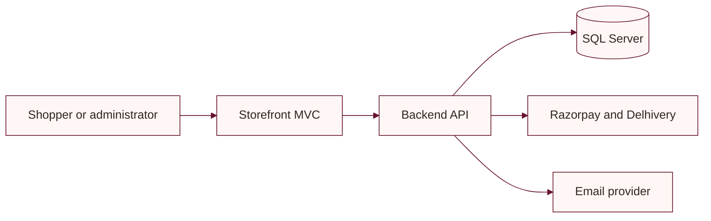

# Engineering documentation

This index links the current product and engineering guides. Setup values and implementation details should be checked against source configuration before deployment.

## Product and design

- [Product requirements](PRD.md)
- [Design system](DESIGN_SYSTEM.md)
- [Implementation status and follow-up plan](IMPLEMENTATION_PLAN.md)

## Engineering

- [Architecture](ARCHITECTURE.md)
- [Application flow](APP_FLOW.md)
- [Backend schema](BACKEND_SCHEMA.md)
- [Security](SECURITY.md)
- [Testing](TESTING.md)
- [Code style](CODE_STYLE.md)
- [Contributor and agent guide](AGENTS.md)

## Provider and setup guides

- [Razorpay webhook setup](RAZORPAY_WEBHOOK_SETUP.md)
- [Address checkout](../ADDRESS_CHECKOUT_SETUP.md)
- [Admin panel](../ADMIN_SETUP.md)
- [Razorpay payments](../RAZORPAY_SETUP.md)
- [Razorpay to Delhivery automation](../RAZORPAY_DELHIVERY_AUTOMATION_TESTING.md)
- [Delhivery integration](../DELHIVERY_SETUP.md)
- [Customer account and SMTP setup](../backend/ACCOUNT_SETUP.md)
- [Email verification](../frontend/EMAIL_VERIFICATION_SETUP.md)

## Core system flow

