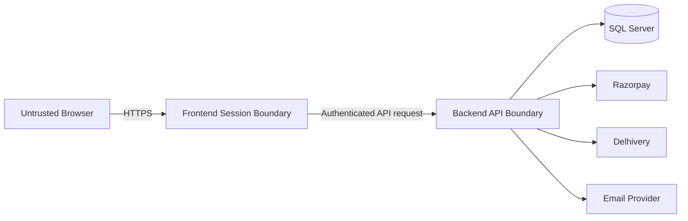

# Security Guide
### Protecting customers, payments and store operations

**Security is a design constraint across every layer—not a final checklist.**

---

## 01 · Trust boundaries

Validate every value crossing a boundary. Browser validation improves usability but does not replace backend validation.

## 02 · Secrets and configuration

- Never commit live credentials, API tokens, SMTP passwords, database passwords or JWT signing keys.
- Use environment variables, .NET User Secrets for local development, or a managed secret store in production.
- Keep separate credentials for test/staging and production.
- Rotate credentials after accidental exposure and review repository history if a secret was committed.
- Ensure logs and exception responses never expose secret values.
- Keep `appsettings.example.json` values as placeholders only.

## 03 · Authentication and authorization

- Use strong password hashing; never store plaintext passwords.
- Protect cookie sessions with secure, HTTP-only and appropriate SameSite settings.
- Require HTTPS in production.
- Validate JWT issuer, audience, signature and expiry.
- Apply authorization policies at API endpoints, not only by hiding frontend links.
- Keep customer and admin authentication contexts separate.
- Verify resource ownership for addresses, orders, reviews and account actions.
- Use short-lived, single-use password-reset tokens and invalidate them after use.

## 04 · Payments

- Keep Razorpay secret keys on the backend.
- Create payment orders from trusted server-side totals.
- Verify payment signatures on the backend.
- Reconcile uncertain outcomes with the provider before retrying.
- Make webhook handling idempotent and validate webhook signatures.
- Never mark an order Paid based only on a browser redirect or client-side success callback.
- Do not log full payment credentials or sensitive payment payloads.

## 05 · Shipping

- Keep Delhivery tokens server-side.
- Require admin authorization for shipment creation and pickup operations.
- Verify order state and payment eligibility before manifestation.
- Validate PIN serviceability, recipient details and parcel weight.
- Persist AWB and shipment status only after a successful carrier response.
- Prevent duplicate shipment creation and use a safe reconciliation path after timeouts.
- Avoid logging full addresses, phone numbers or provider payloads during normal operation.

## 06 · Input, files and database

- Validate all request DTOs on the server.
- Use parameterized EF Core queries; do not concatenate untrusted SQL.
- Validate upload extension, content type, file signature, size and generated filename.
- Store uploads outside executable application paths and persist them durably.
- Prevent path traversal and arbitrary file access.
- Apply least-privilege database credentials.
- Back up data securely and test restore procedures.

## 07 · Browser security

- Encode output and avoid unsafe HTML injection.
- Use anti-forgery protection for cookie-authenticated state-changing MVC actions.
- Configure CORS narrowly; do not use wildcard origins with credentials.
- Add appropriate security headers, including a considered Content Security Policy.
- Avoid putting tokens or private data in URLs, local storage or analytics events.
- Use dependency updates and vulnerability scanning as part of maintenance.

## 08 · Logging and incident response

Log enough context to diagnose issues: timestamp, correlation ID, route, safe entity identifier and outcome. Redact credentials, authorization headers, reset tokens, full payment data and unnecessary personal information.

If a credential or customer dataset is exposed:

1. Restrict access and stop further exposure.
2. Rotate/revoke affected credentials.
3. Preserve relevant logs securely.
4. Assess affected data and systems.
5. Follow applicable incident and customer-notification obligations.
6. Document root cause and preventive actions.

## 09 · Release security gate

- [ ] No secrets in tracked files or build artifacts.
- [ ] HTTPS and secure cookie settings verified.
- [ ] Admin endpoints enforce authorization.
- [ ] Customer ownership checks tested.
- [ ] Payment signature and webhook verification tested.
- [ ] Duplicate payment/shipment requests handled safely.
- [ ] Upload validation and storage permissions reviewed.
- [ ] Error responses do not leak stack traces or secrets.
- [ ] Dependencies and production configuration reviewed.

> [!WARNING]
> A security badge, certification logo or compliance claim must not be displayed unless UBHAYA has actually obtained and can substantiate that certification.
