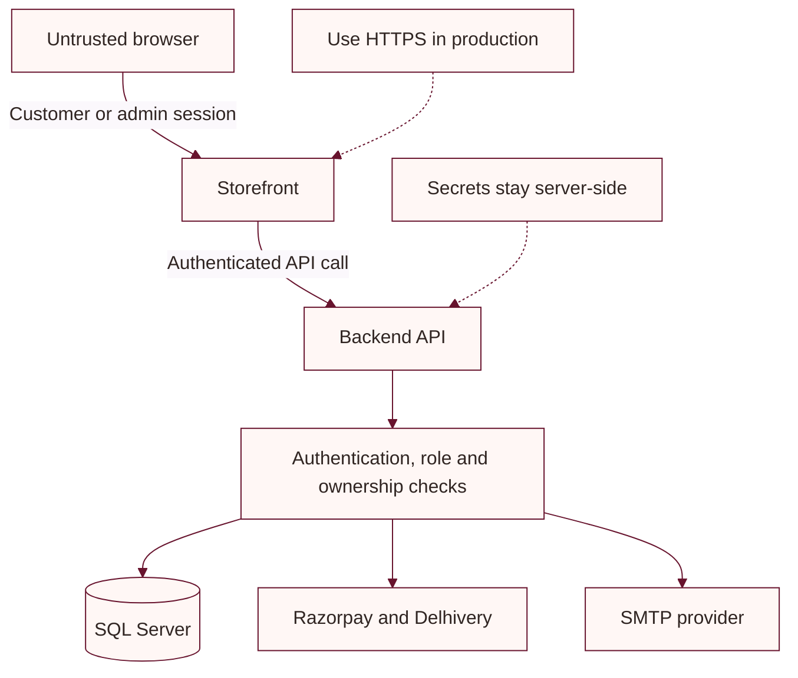

# Security notes

This document records controls visible in the application source and the operational settings that must be supplied by the deployment environment. It is not a security certification.

## Implemented controls

- The API uses JWT bearer authentication for protected API requests.
- Middleware checks that the authenticated customer/admin account remains active and prevents customer tokens from accessing admin routes.
- Backend admin APIs use role authorization; admin account management is additionally restricted to the owner email.
- The MVC storefront stores customer and admin sessions in separate HttpOnly cookies.
- Frontend forms use ASP.NET Core antiforgery support.
- Passwords are hashed with BCrypt. Reset tokens and verification codes are stored as hashes and expire.
- Razorpay payment and webhook signatures are verified server-side using constant-time comparison.
- Razorpay webhook events are persisted with a unique provider event ID to prevent duplicate processing.
- The frontend sets `X-Content-Type-Options: nosniff`, `Referrer-Policy: strict-origin-when-cross-origin`, and a `Permissions-Policy` that limits geolocation to the site and blocks camera/microphone.
- Uploaded media is served from the configured shared uploads directory.

## Deployment responsibilities

- Supply strong JWT signing keys, database credentials, Razorpay/Delhivery tokens, OAuth secrets, and SMTP credentials through a secret manager or protected environment variables.
- Use HTTPS in production and configure secure cookie behavior at the hosting boundary. The frontend source currently supports an HTTP EC2 test setup and does not enable HSTS or HTTPS redirection in its pipeline.
- Limit production database and uploads access, maintain backups, and plan migrations with rollback.
- Keep Delhivery support payload logging disabled during normal operation because requests include customer information.
- Restrict browser Google Maps keys to the storefront origin and enabled APIs.
- The backend `AllowFrontend` CORS policy currently permits any origin, header, and method. Restrict it to the deployed storefront origin and required methods/headers before production.

## Security boundary flow

Do not put provider secrets in Razor views, JavaScript, public feeds, or client-visible responses. Report only controls verified in code or configuration.
