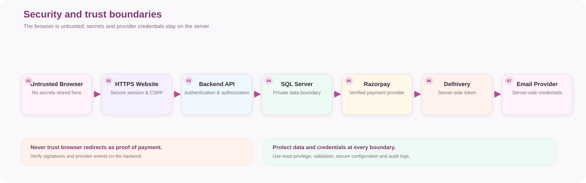

UBHAYA FASHIONS · TRUST & SAFETYProtect every transaction
<h1>Security Guide</h1>

Practical safeguards for customer identity, payments, shipping, uploaded files, production data and store operations.

<strong>Security model</strong>Layered controls

<strong>Trust boundary</strong>Browser → API

<strong>Priority</strong>Production safety

## <strong>01</strong> Trust boundaries

<figure class="doc-diagram">
  
  <figcaption>Security trust boundaries between browser, website, backend and external providers.</figcaption>
</figure>

Validate every value crossing a boundary. Browser validation is for usability; backend validation is mandatory.

## <strong>02</strong> Security pillars

🔑<strong>Secrets</strong>
Keep credentials out of source control and browser code.

🪪<strong>Identity</strong>
Separate customer and admin authentication contexts.

💳<strong>Payments</strong>
Verify signatures and reconcile uncertain outcomes.

🚚<strong>Shipping</strong>
Protect carrier tokens and shipment operations.

📁<strong>Uploads</strong>
Validate file content and store outside executable paths.

📋<strong>Observability</strong>
Log safely without exposing personal or secret data.

## <strong>03</strong> Authentication and authorization

- Use strong password hashing; never store plaintext passwords.
- Use secure, HTTP-only cookies and HTTPS in production.
- Validate JWT signature, issuer, audience and expiry.
- Enforce authorization on API endpoints.
- Check ownership for customer orders, addresses, reviews and account actions.
- Keep admin and customer credentials/claims separate.
- Use expiring, single-use password-reset tokens.

## <strong>04</strong> Payment protection

| Control | Requirement |
|---|---|
| API keys | Secret key stays on backend |
| Amount | Calculate from trusted server-side data |
| Signature | Verify on backend |
| Webhook | Validate signature and event identity |
| Duplicate event | Process idempotently |
| Timeout | Reconcile before retrying |
| Order state | Never trust browser redirect alone |

## <strong>05</strong> Shipping protection

- Keep Delhivery API token server-side.
- Require admin authorization for shipment and pickup operations.
- Check order state and payment eligibility before manifestation.
- Validate destination PIN, recipient details and parcel weight.
- Save AWB only after confirmed successful response.
- Prevent duplicate shipment creation.
- Redact personal details from normal logs.

## <strong>06</strong> Input, files and database

- Validate request DTOs on the server.
- Use parameterized EF Core queries.
- Validate file extension, MIME type, signature and size.
- Generate safe filenames and prevent path traversal.
- Store uploads outside executable application directories.
- Use least-privilege database credentials.
- Back up database and uploads separately; test restore.

## <strong>07</strong> Release security gate

✓<strong>Identity and access</strong>
Authorization, customer ownership and secure sessions tested.

✓<strong>Payment integrity</strong>
Signatures, webhooks and duplicate events tested.

✓<strong>Data protection</strong>
Secrets, uploads, logs and backups reviewed.

✓<strong>Operations</strong>
Errors, monitoring and recovery process verified.

- [ ] No live secrets in tracked files or build artifacts.
- [ ] HTTPS and secure cookie settings verified.
- [ ] Admin and customer authorization tested.
- [ ] Upload validation and storage permissions reviewed.
- [ ] Error responses do not leak secrets or stack traces.
- [ ] Dependency and production configuration review completed.

⚠️
<b>Certification claims</b> Do not display security certification logos or compliance claims unless UBHAYA has obtained and can substantiate the certification.

UBHAYA FASHIONS · Security handbook · Revisit after authentication, payment, upload or infrastructure changes.

