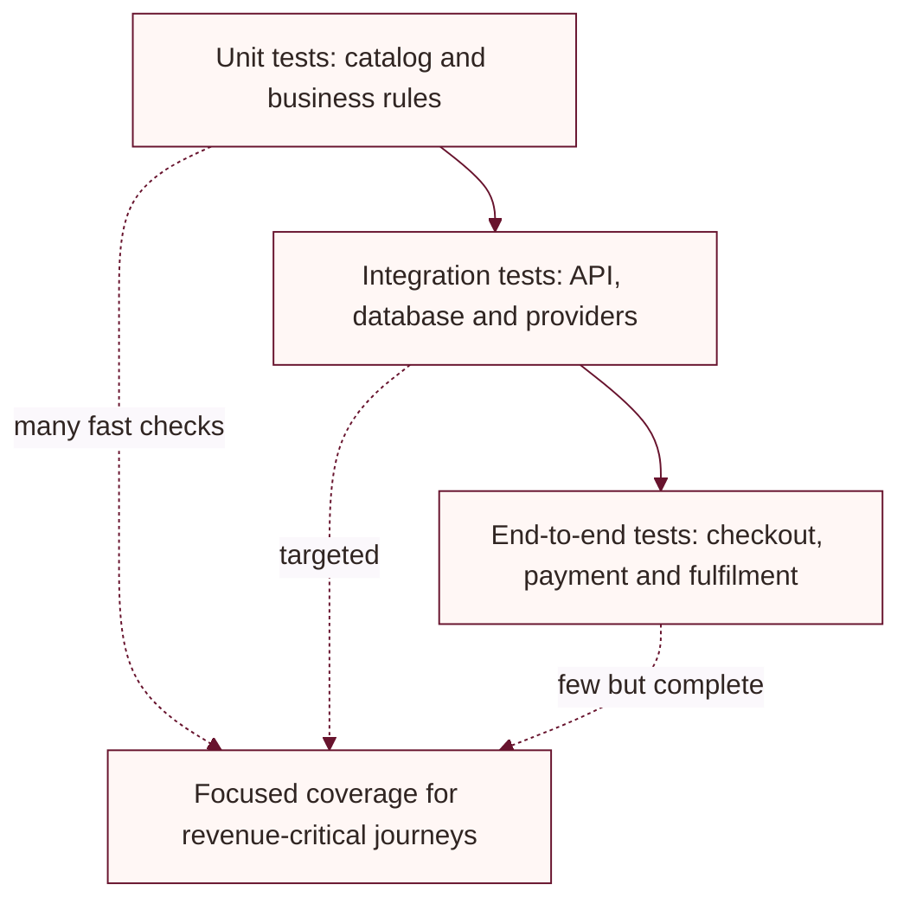
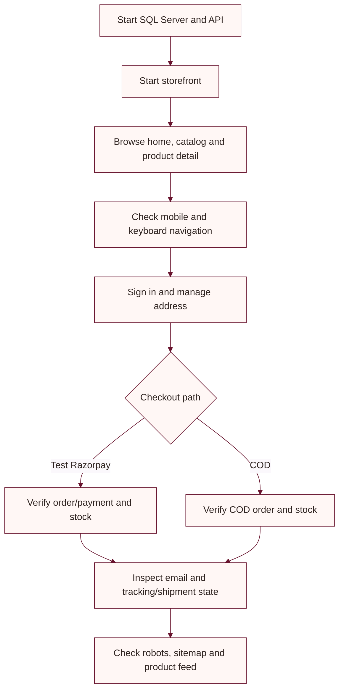

# Testing guide

This guide describes the available automated test project and useful manual journeys. It does not report a test run.

## Automated tests

Run these commands from the repository root:

```powershell
dotnet build LadiesDressStore.sln
dotnet test tests/UbhayaFashions.Tests/UbhayaFashions.Tests.csproj
```

The current xUnit project contains tests for product color normalization/matching and price-ceiling behavior. It does not currently represent broad API, browser, payment-provider, or accessibility integration coverage.

## Recommended test layers

The diagram shows a recommended coverage mix, not the current automated test inventory.



## Manual smoke-test flow



## Recommended focused checks

- Catalog: missing product, unavailable variant, zero stock, and invalid quantity.
- Account: signup, login, optional email verification, reset expiry and one-time use.
- Address: add/edit/delete, default selection, ownership, and location permission denied.
- Payment: signature mismatch, unpaid status, amount/order mismatch, retry, webhook duplicate, and inventory race.
- Shipping: missing configuration, provider rejection, timeout/possible duplicate, and admin retry.
- SEO: `/robots.txt`, `/llms.txt`, `/sitemap.xml`, and `/feeds/google-products.xml`.
- Accessibility: keyboard-only use, focus visibility, labels, contrast, zoom/reflow, and screen reader announcements.
- Responsive behavior: test common narrow mobile and desktop widths for overflow and clipped controls.

Use Razorpay test mode and Delhivery staging for provider checks. Never create a real customer payment to smoke-test local code. Record environment, URL, device profile, and actual output when sharing results.
