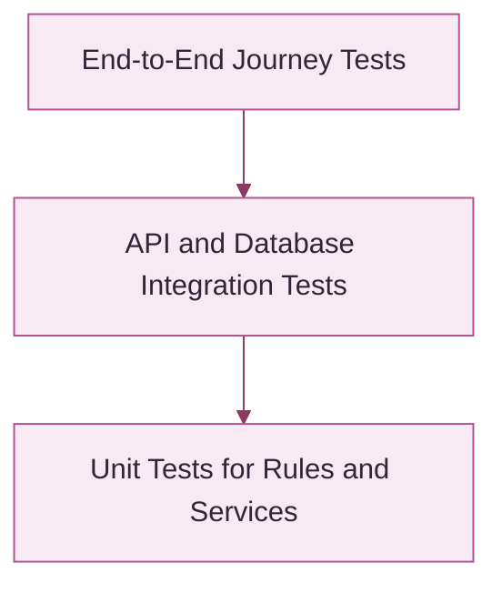

<div class="doc-hero">
<span class="doc-kicker">UBHAYA FASHIONS · QUALITY ENGINEERING</span><span class="doc-pill">Turn tests into a stable product</span>
<h1>Testing Guide</h1>
<p>A practical test strategy to confirm the application is functional, secure, performant and ready for production.</p>
<div class="doc-meta"><div><strong>Scope</strong>Frontend · Backend · Integrations</div><div><strong>Test layers</strong>Unit · Integration · E2E</div><div><strong>Goal</strong>Release confidence</div></div>
</div>

## <strong>01</strong> Testing overview

| Area | Coverage |
|---|---|
| Product | Search, filters, variants, price and availability |
| Customer | Registration, login, reset password and addresses |
| Commerce | Cart, checkout, orders and inventory |
| Integrations | Razorpay, webhooks, email and Delhivery |
| Experience | Responsive UI, accessibility and performance |
| Operations | Migrations, uploads, backups and recovery |

## <strong>02</strong> Testing goals

<div class="doc-grid">
<div class="doc-card pink"><span class="ico">✓</span><strong>Feature correctness</strong><p>Ensure core features behave as expected.</p></div>
<div class="doc-card purple"><span class="ico">👥</span><strong>User experience</strong><p>Provide a smooth experience across devices.</p></div>
<div class="doc-card orange"><span class="ico">🛡️</span><strong>Early defect detection</strong><p>Catch and fix bugs before release.</p></div>
<div class="doc-card blue"><span class="ico">⏱️</span><strong>Performance</strong><p>Maintain responsive pages and reliable APIs.</p></div>
<div class="doc-card green"><span class="ico">♿</span><strong>Accessibility</strong><p>Support inclusive interaction patterns.</p></div>
<div class="doc-card yellow"><span class="ico">🔒</span><strong>Data security</strong><p>Keep customer and transaction data protected.</p></div>
</div>

## <strong>03</strong> Test strategy



Use many fast unit tests, focused integration tests for important boundaries and a smaller number of end-to-end tests for revenue-critical journeys.

## <strong>04</strong> Critical user flows

<div class="doc-grid four">
<div class="doc-card pink"><span class="ico">👤</span><strong>01 · Account</strong><p>Register, verify, sign in, reset password.</p></div>
<div class="doc-card purple"><span class="ico">👗</span><strong>02 · Shopping</strong><p>Browse, filter, select variants and cart.</p></div>
<div class="doc-card blue"><span class="ico">💳</span><strong>03 · Payment</strong><p>Checkout, signature verification and webhook.</p></div>
<div class="doc-card green"><span class="ico">🚚</span><strong>04 · Fulfilment</strong><p>Manifest, AWB, tracking and delivery.</p></div>
</div>

## <strong>05</strong> Example test cases

| ID | Feature | Scenario | Expected result |
|---|---|---|---|
| TC-01 | Registration | Valid email and details | Account created / verification sent |
| TC-02 | Login | Invalid password | Safe error; no session |
| TC-03 | Catalogue | Filter by colour and size | Only matching products shown |
| TC-04 | Cart | Add unavailable variant | Request rejected with clear message |
| TC-05 | Payment | Invalid signature | Payment not marked paid |
| TC-06 | Webhook | Replay same event | No duplicate stock deduction |
| TC-07 | Shipping | Non-serviceable PIN | No shipment manifested |
| TC-08 | Authorization | Access another customer's order | Request denied |

## <strong>06</strong> Test commands

```bash
dotnet build LadiesDressStore.sln
dotnet test tests/UbhayaFashions.Tests/UbhayaFashions.Tests.csproj
```

Run from the repository root. Confirm the current solution and test project paths before adapting commands.

## <strong>07</strong> Testing checklist

<div class="doc-grid">
<div class="doc-card green"><span class="ico">🧪</span><strong>Functional</strong><p>Core features and business rules.</p></div>
<div class="doc-card purple"><span class="ico">🌐</span><strong>Cross-browser</strong><p>Chrome, Edge, Firefox and Safari where available.</p></div>
<div class="doc-card blue"><span class="ico">📱</span><strong>Mobile</strong><p>Small and large Android/iOS viewports.</p></div>
<div class="doc-card yellow"><span class="ico">🚀</span><strong>Performance</strong><p>PageSpeed, Lighthouse and API timings.</p></div>
<div class="doc-card pink"><span class="ico">♿</span><strong>Accessibility</strong><p>Keyboard, contrast, labels and focus.</p></div>
<div class="doc-card orange"><span class="ico">🔐</span><strong>Security</strong><p>Authorization, validation and secret handling.</p></div>
</div>

## <strong>08</strong> Release acceptance

- [ ] Solution builds successfully.
- [ ] Automated tests pass.
- [ ] Critical customer journeys verified.
- [ ] Payment signature and duplicate webhook behaviour verified.
- [ ] Shipment eligibility and duplicate protection verified.
- [ ] Database migration reviewed and backup confirmed.
- [ ] Production configuration validated.
- [ ] Upload and database persistence verified after deployment.
- [ ] Mobile and desktop smoke tests complete.

<div class="doc-footer">UBHAYA FASHIONS · Testing handbook · Record actual test evidence; never mark unexecuted tests as passed.</div>
