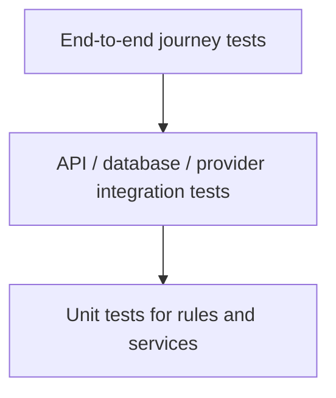

<div align="center">

# Testing Strategy
### Confidence before every release

**Test business behaviour, trust boundaries and the complete customer journey.**

</div>

---

## 01 · Test pyramid



Use many fast unit tests, focused integration tests for important boundaries and a smaller set of end-to-end tests for revenue-critical journeys.

## 02 · Local commands

Run from the repository root:

```bash
dotnet build LadiesDressStore.sln
dotnet test tests/UbhayaFashions.Tests/UbhayaFashions.Tests.csproj
```

The test project path is documented in the root README. If the solution or test project layout changes, update these commands.

## 03 · High-value test areas

| Area | Scenarios |
|---|---|
| Catalogue | Search, filters, sorting, variant availability, colour matching |
| Pricing | Discounts, rounding, authoritative totals, currency precision |
| Inventory | Concurrent updates, insufficient stock, restore on valid cancellation |
| Identity | Registration, verification, login, reset token expiry and reuse |
| Authorization | Customer cannot access another customer's order/address; non-admin cannot call admin API |
| Cart and checkout | Invalid variant, stale price, stock change, invalid address |
| Payments | Valid/invalid signature, duplicate callback, timeout and reconciliation |
| Webhooks | Signature validation, replay/idempotency and out-of-order events |
| Shipping | Non-serviceable PIN, missing pickup location, provider timeout, duplicate manifestation |
| Uploads | Invalid type, oversized file, unsafe filename and storage failure |
| UI | Mobile overflow, navigation, form errors, loading and empty states |

## 04 · Payment test matrix

| Given | Expected outcome |
|---|---|
| Valid provider payment and valid signature | Payment becomes verified; order follows the paid workflow |
| Invalid signature | Reject verification; do not mark paid |
| Browser says success but server verification fails | Do not trust browser result |
| Duplicate webhook/callback | No duplicate order or stock reduction |
| Provider timeout | Preserve an unknown/pending outcome and reconcile |
| Payment failure | Show safe retry path without duplicate order creation |

Use Razorpay test credentials and test mode for non-production verification. Never use live credentials in automated tests.

## 05 · Shipping test matrix

- Valid, serviceable PIN and eligible paid order.
- Non-serviceable PIN.
- Missing or inactive pickup location.
- Invalid recipient address or parcel weight.
- Provider rejects client name or payload.
- Timeout after provider may have accepted the request.
- Repeated admin click or duplicate request.
- Successful AWB response and customer tracking.
- Tracking provider temporarily unavailable.

Use Delhivery staging credentials where available. Confirm account-specific behaviour with Delhivery before testing production shipments.

## 06 · UI and performance checks

- Test mobile widths and desktop layouts.
- Check horizontal overflow, image aspect ratios and layout shifts.
- Verify keyboard navigation and focus states.
- Confirm all interactive controls have loading and disabled states.
- Run Lighthouse/PageSpeed on home, product listing and product detail pages.
- Compare before/after results using the same device profile and test conditions.
- Optimize the largest contentful image and avoid loading below-the-fold media eagerly.

## 07 · Release gate

- [ ] Solution builds cleanly.
- [ ] Automated tests pass.
- [ ] Critical customer journey verified.
- [ ] Payment verification and duplicate-event behaviour verified.
- [ ] Shipment eligibility and duplicate protection verified.
- [ ] Database migration reviewed and backup confirmed.
- [ ] Production secrets/configuration validated.
- [ ] Upload and database persistence verified after deployment.
- [ ] Mobile and desktop smoke tests complete.
- [ ] Logs and health checks reviewed after release.

## 08 · Test data and environments

- Use synthetic customer information.
- Keep test and production credentials separate.
- Never point automated destructive tests at production.
- Reset test data deterministically.
- Avoid depending on unstable third-party services in unit tests; mock provider boundaries and reserve sandbox calls for integration checks.
